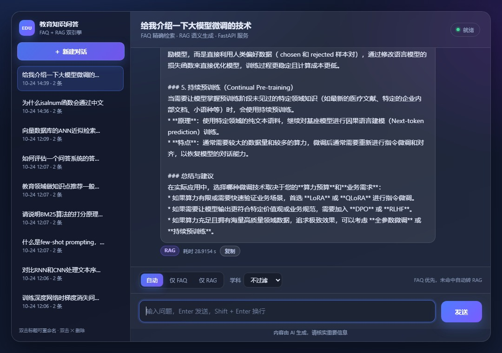

# EduRAG 集成问答系统

单服务、双链路的教育领域问答系统：**FAQ**（MySQL + BM25 + Redis）优先，未命中转 **RAG**（Milvus + BGE 精排 + 大模型生成）。对外只暴露一套页面与一个问答接口。

- 详细开发文档：[readme/开发文档-详细版.md](readme/开发文档-详细版.md)
- 简略版副本：[readme/开发文档-简略版.md](readme/开发文档-简略版.md)
- 压测报告（P95 / P99）：[readme/压测报告.md](readme/压测报告.md)　｜　可视化版：`readme/压测报告.html`
- **容量与部署建议手册**：[readme/建议手册.md](readme/建议手册.md)　（本机基线参数 → 100 并发算力推算 → 按规模调参）
- 项目介绍页（单文件离线版，双击即可打开）：`readme/project-intro.html`（仅本地保留，未纳入版本库）
- 项目结构图：[readme/architecture.svg](readme/architecture.svg)　｜　请求流程图：[readme/flow.svg](readme/flow.svg)


---

## 快速启动

```bash
# 1) 安装依赖（版本锁定见 requirements.txt，来自 conda env edurag / Python 3.12.14）
pip install -r requirements.txt --extra-index-url https://download.pytorch.org/whl/cu126

# 2) 生成本地配置，并把 DashScope API Key 填进 config.ini
cp config.example.ini config.ini        # PowerShell: Copy-Item config.example.ini config.ini

# 3) 前置服务：Milvus + Redis 可一键起（见 milvus_redis/README.md），MySQL 需自行安装
cd milvus_redis && docker compose up -d && cd ..
curl http://localhost:9091/healthz     # 返回 OK 表示 Milvus 就绪

# 4) 模型：按下方「模型准备」下载后放到 rag_qa/models/

python app_async.py      # FastAPI + Uvicorn → http://127.0.0.1:8000
```

启动顺序：FAQ 预热（jieba + BM25 索引，秒级）→ RAG 预热（后台加载 BGE-M3 / reranker，数十秒）→ 接收请求。

> `config.ini` 含 API Key，已被 `.gitignore` 忽略，不会进入仓库；仓库内只提供脱敏的 `config.example.ini`。

---

## 模型准备（不随仓库分发）

模型权重合计约 **5.4 GB**，体积过大未提交，需自行下载后按目录名放置到 `rag_qa/models/` 下。

| 目录 | 模型 | 用途 | 官方下载 |
|---|---|---|---|
| `bge-m3` | BAAI/bge-m3 | 混合检索的 dense + sparse 编码 | [HuggingFace](https://huggingface.co/BAAI/bge-m3) ｜ [ModelScope](https://modelscope.cn/models/BAAI/bge-m3) |
| `bge-reranker-large` | BAAI/bge-reranker-large | 检索结果精排（CrossEncoder） | [HuggingFace](https://huggingface.co/BAAI/bge-reranker-large) ｜ [ModelScope](https://modelscope.cn/models/BAAI/bge-reranker-large) |
| `bert-base-chinese` | google-bert/bert-base-chinese | 意图分类的底座模型 | [HuggingFace](https://huggingface.co/google-bert/bert-base-chinese) ｜ [ModelScope](https://modelscope.cn/models/google-bert/bert-base-chinese) |
| `nlp_bert_document-segmentation_chinese-base` | damo/nlp_bert_document-segmentation_chinese-base | 文档语义分割（备用切分器） | [ModelScope](https://modelscope.cn/models/damo/nlp_bert_document-segmentation_chinese-base) |
| `bert_query_classifier` | **本项目自训练** | 意图分类微调权重（通用知识 / 专业咨询） | 无官方下载，复现方式见下 |

**下载方式一：ModelScope（国内网络更稳）**

```bash
pip install -U modelscope
modelscope download --model BAAI/bge-m3 --local_dir rag_qa/models/bge-m3
modelscope download --model BAAI/bge-reranker-large --local_dir rag_qa/models/bge-reranker-large
modelscope download --model google-bert/bert-base-chinese --local_dir rag_qa/models/bert-base-chinese
```

**下载方式二：HuggingFace（需 git-lfs）**

```bash
git lfs install
git clone https://huggingface.co/BAAI/bge-m3 rag_qa/models/bge-m3
git clone https://huggingface.co/BAAI/bge-reranker-large rag_qa/models/bge-reranker-large
git clone https://huggingface.co/google-bert/bert-base-chinese rag_qa/models/bert-base-chinese
```

**复现意图分类权重 `bert_query_classifier`：**

```python
# 训练数据：rag_qa/data/model/model_generic_2000.json（仓库内已提供）
from rag_qa.core.query_classifier import QueryClassifier
clf = QueryClassifier()                       # 首次会从 bert-base-chinese 初始化
clf.train_model("rag_qa/data/model/model_generic_2000.json")
clf.save_model()                              # 输出到 models/bert_query_classifier
```

> 若暂时不训练，也可跳过：`rag_system.py` 会回退加载 `bert-base-chinese` 并随机初始化分类头，
> 分类结果因此不可用，表现是所有问题都按「专业咨询」走 RAG 流程。生产环境建议补齐该权重。

---

## 架构一眼看懂

```
浏览器 → 唯一前端（templates/ + static/）
        → app_async.py                 入口层（唯一入口）
        → qa_router.py                 路由层（ask_faq / ask_rag，无状态）
             ├─ FAQ  mysql_qa/  → BM25 → Redis 缓存 → MySQL knowledge
             │       返回 (answer, need_rag)，need_rag 决定是否降级
             └─ RAG  rag_qa/    → 混合检索 → 父块去重 → rerank → 注入历史 → LLM 生成
        → chat_store（MySQL: conversations / chat_sessions）落库 → 返回 JSON
```

| 链路 | 数据源 | 检索 | 生成 | 耗时 | 触发条件 |
|---|---|---|---|---|---|
| FAQ | MySQL `knowledge` | BM25 + softmax，最高分 > 0.85 | 直接取标准答案 | 毫秒 | `auto` 下永远先试 |
| RAG | Milvus `edurag_final` | BGE-M3 dense(0.7)+sparse(0.3) → 父块去重 → reranker Top2 | DashScope 生成（带最近 5 轮历史） | 秒 | `need_rag=true` 或 `mode=rag` |

`mode` 三态：`auto`（默认，FAQ 优先）/ `faq`（只查 FAQ）/ `rag`（只走 RAG）。

`auto` 模式下的流转由 FAQ 返回的 `need_rag` 标志驱动：命中即返回；未命中、答案为空或 FAQ 自身异常时置 `true` 并转 RAG；仅当查询本身无效（`need_rag=false` 且无答案）时直接返回未命中，避免为空查询白跑一次 BGE + 大模型。

---

## 响应耗时对比

同一套前端、同一个 `POST /query` 接口，只是命中的链路不同（本地实测）：

| FAQ 链路（精确检索） | RAG 链路（检索 + 生成） |
|---|---|
|  |  |
| **0.0138 s** · BM25 命中后直接取标准答案 | **28.9154 s** · 分类 → 选策略 → 检索 → 精排 → 生成 |

两者相差 3 个数量级以上。截图里的 FAQ 耗时是**服务端 `elapsed` 口径**（不含 HTTP 与会话落库），与下方端到端分位数不可直接比较；28.9154 s 为单次样本（多段串行调用），RAG 耗时会随问题复杂度与生成长度波动，不宜当作平均值。

### 压测分位数（更可信的口径）

单次样本容易失真，下面是固定并发、批量样本下的分位数（异步版，2026-10-24；完整口径与同步版对照见 [readme/压测对比报告-同步vs异步.md](readme/压测对比报告-同步vs异步.md)）：

| 链路 | 口径 | 并发 | 样本 | P50 | P95 | P99 |
|---|---|---|---|---|---|---|
| FAQ | 冷缓存 · 端到端 | 8 | 300 | 31.0 ms | **37.3 ms** | 635.5 ms |
| FAQ | 冷缓存 · 服务端处理 | 8 | 300 | 12.8 ms | 17.8 ms | 305.9 ms |
| FAQ | 热缓存 · 端到端 | 8 | 200 | 21.5 ms | **30.0 ms** | 34.3 ms |
| RAG | 端到端（LLM 直答） | 2 | 24 | 33.2 s | **41.0 s** | 42.2 s |

- FAQ 吞吐：并发 8 时 **170 req/s**，并发 16 时回落到 124 req/s（16 核下 FAQ 是 CPU 密集，闸门给到 16 反而抢 GIL）。
- 冷缓存的 P99 有少量 0.6 s 级抖动样本，P50/P95 更能代表稳态。
- RAG 的 P95/P99 反映的是大模型生成耗时，与系统自身处理能力基本无关。

> 注意：本次压测时意图分类器全部输出「通用知识」，RAG 实际走的是「大模型直答」分支，未触发 Milvus 检索与 BGE 精排，故上表 RAG 数字不含检索开销。

### 历史版本：Flask 同步版（已移除）

项目早期有一个 Flask 同步入口 `app.py`（开发服务器，:5000），作为对比基线保留了一轮完整压测，已在 2026-10-24 移除，不再纳入代码库。保留这段记录的理由是它解释了本项目的架构选型：

| 口径（并发 8 · 冷缓存 · 300 样本） | Flask 同步版 | 当前异步版 | 变化 |
|---|---|---|---|
| FAQ 端到端 P95 | 1546.5 ms | **37.3 ms** | −97.6% |
| FAQ 吞吐 | 6.51 req/s | **170.1 req/s** | ×26 |
| 框架外开销（P50） | 1053 ms | 18.2 ms | −98.3% |

差异的 92% 来自「每请求新建线程 → 每请求新建 MySQL 连接」，而不是 Web 框架本身：开发服务器一请求一线程，`chat_store` 的线程本地连接永远复用不上，单次建连在压测机上实测 168 ms。异步版用固定线程池 + `run_sync` 把连接复用回来，同时消除了「并发上升 → 延迟线性劣化」的结构性缺陷。完整拆解见 [readme/压测对比报告-同步vs异步.md](readme/压测对比报告-同步vs异步.md)。

---

## 目录速查

| 路径 | 作用 |
|---|---|
| `app_async.py` | 唯一入口（FastAPI + Uvicorn），只负责 HTTP、并发闸门与落库 |
| `qa_router.py` | 路由层：`ask_faq`、`ask_rag`、`make_result`、预热、能力描述（无状态，供入口层复用） |
| `templates/index.html`、`static/*` | 唯一前端：会话列表、模式切换、学科过滤、引擎徽标 |
| `base/` | `Config`（读 config.ini）+ 单例 `logger` |
| `mysql_qa/` | FAQ 能力包：`utils`（单例/组合器/会话存储）、`retrieval`、`db`、`cache` |
| `rag_qa/` | RAG 能力包：`rag_service`、`core`（检索/生成/切块/缓存）、`edu_*` 加载与切分 |
| `readme/` | 详细版 / 简略版、压测报告（历史存档）、压测对比报告、建议手册、结构图、流程图、实测截图 |
| `loadtest/` | 压测原始明细 `results/*.json`（脚本已移除，文件名为 `{场景}_{批次}_c{并发}_n{请求数}.json`） |
| `milvus_redis/` | Milvus + Redis 的 `docker-compose.yml` 与部署说明（含可修改项清单） |

---

## 接口速查

`POST /query`

```json
// 请求
{"query": "AI 学科的课程大纲", "session_id": 3, "mode": "auto", "source": "ai"}

// 响应
{"code": 0, "session_id": 3, "title": "AI 学科的课程大纲", "answer": "……",
 "found": true, "engine": "rag", "elapsed": 3.2145, "note": "FAQ 无可靠答案，已转 RAG"}
```

| 字段 | 说明 |
|---|---|
| `mode` | `auto` / `faq` / `rag`，非法值回退 `auto` |
| `source` | 学科过滤，仅 RAG 生效，取值见 `valid_sources` |
| `engine` | `faq` / `rag` / `none`，真正产出答案的链路 |
| `found` | `false` 时 `answer` 为兜底文案 |
| `note` | 过程说明，前端做悬浮提示 |

其余接口：`GET /`、`GET /api/meta`、`GET|POST /api/conversations`、`GET|PATCH|DELETE /api/conversations/{id}`、`GET /health`。

---

## 关键实现要点

**包与导入**
- 每层都有 `__init__.py`，统一「包内相对、跨包绝对」：`from .prompts import` / `from rag_qa.core.vector_store import` / `from base import`。
- 只有入口层改 `sys.path`（且只插项目根）；库模块里不再出现 `sys.path.insert`。
- 子包 re-export 常用类（`from mysql_qa.db import MySQLClient`、`from mysql_qa.retrieval import BM25Search`），但**包入口不做聚合导出**——否则轻量导入会被 torch / jieba / modelscope 拖慢。
- 完整约定见 `readme/开发文档-详细版.md` §3.1。

**FAQ 链路**
- 单例 + 预热：`mysql_qa/utils/qa_service.get_qa_system()` / `ensure_ready()`。
- 索引：启动时 `select question from knowledge` → jieba 分词 → BM25；daemon 线程每 30 分钟重新同步。
- 容量规划：单学科知识对体量很大时可按 `subject_name` 分区（主键需改为 `(id, subject_name)`，LIST COLUMNS 或 KEY 分区），建表写法与限制见 `readme/开发文档-详细版.md` §8.5.1。
- 判定：Redis `answer:{query}` 命中即返回；否则 BM25 打分 → softmax → 最高分 > 0.85 才算命中。
- 返回值契约：`BM25Search.search()` / `MySQLQASystem.query()` 统一返回 `(answer, need_rag)`。命中问题但 `fetch_answer` 为空时不写缓存，按「无可用答案」置 `need_rag=true`，避免空值污染 Redis。
- 命中后用最相似的历史问题去 MySQL 取标准答案，并回写缓存。

**RAG 链路**
- 单例 + 失败冷却 60 s：Milvus 或模型不可用时快速失败，避免每请求重连。
- 意图分流：BERT 分类器（`models/bert_query_classifier` 微调权重）判断问题类型，「通用知识」不检索直接作答，「专业咨询」才进检索。
- 策略分派：LLM 选策略 → `strategy.strip()` → `retrieve_and_merge` 分派到回溯 / 子查询 / HyDE / 直接检索（不匹配时退化为直接检索）。
- 混合检索：dense 0.7 + sparse 0.3（`IP`，`k=retrieval_k`）→ 子块按 `parent_content` 去重还原父块 → `bge-reranker` 精排取 `candidate_m` 条。
- 对话历史：`generate_answer(query, source_filter, history)` 接收最近 5 轮问答，格式化为 `Q:…/A:…` 注入提示词；单条截断 200 字、整体预算 1500 字，超出时优先丢弃更早的轮次。
- 生成：`rag_prompt(context, history, question, phone)` → DashScope；无可靠上下文时输出含客服电话的兜底句。

**会话存储**
- MySQL 两张表：`conversations`（一行一轮问答：`session_id / question / answer / timestamp / user_id / meta`）+ `chat_sessions`（会话元信息：标题、归属用户、时间）。
- 会话标识 `session_id` 为 36 位 UUID，未登录也可用（临时 id，`user_id` 为 `NULL`）；登录后调用 `bind_user(session_id, user_id)` 把历史挂到账号名下。
- 线程本地连接（pymysql），首次访问才建表；缺列自动补齐，兼容手工建表/演示 SQL 灌入的数据。
- `add_exchange` 单事务写一轮问答，顺带把默认标题自动改成首个问题。
- `recent_history(session_id, turns=5)` 取最近 N 轮问答对，供 RAG 注入；只有真正转到 RAG 时才查这一次库。
- `conversations.meta` 形如 `FAQ · 耗时 0.0123 s`，前端据此还原引擎徽标。
- 运行期只有 MySQL 这一套实现；SQLite 只剩一次性迁移脚本 `mysql_qa/utils/migrate_sqlite_history.py --apply`（按 uuid5 固定映射导入旧库、重复执行幂等），旧库 `chat_history.db` 已迁移完毕并从仓库清除。
- **保留策略**：临时会话（`user_id IS NULL`）保留 1 天、登录用户保留 30 天，按 `chat_sessions.updated_at` 以会话为单位整体清理；服务启动时自动执行，也可 `python mysql_qa/utils/chat_store.py --purge` 手动触发，阈值在 `config.ini [chat]` 段调整（`auto_purge = false` 可关闭）。

**身份 / 寒暄直答**
- `mysql_qa/utils/smalltalk.py` 维护规则表，全句匹配「你是谁 / 在吗 / 谢谢」这类问题，命中即返回模板文案（耗时微秒级）。
- 直接返回的 `engine` 为 `smalltalk`，前端徽标显示「直答」；规则集中在 `smalltalk.py`，与路由层解耦，改文案不动编排。
- 公司名称与开场白集中在 `COMPANY_NAME` 与 `RULES` 中，替换即可。

**并发与限流**

- 阻塞调用全部 `run_sync` 进线程池；三套 `CapacityLimiter`：FAQ=`max(4, CPU)`、RAG=2、DB=32。
- 超时：FAQ 30 s、RAG 180 s（环境变量可覆盖）。
- single-flight 去重：key = `(question, mode, source, conversation_id)`，同刻相同 key 只算一次。会话必须进 key——历史随会话变化，同一问题跨会话不能共用结果。

---

## 技术栈

| 层 | 组件 |
|---|---|
| 服务 | Python 3.12.14 · FastAPI 0.143 · Uvicorn 0.54 · anyio 4.15 · Jinja2 3.1 |
| 检索 | jieba 0.42 · rank-bm25 0.2 · pymilvus 3.0（dense + sparse 混合检索） |
| 模型 | milvus-model（BGE-M3）· sentence-transformers 6.1（bge-reranker-large）· torch 2.7.1+cu126 · transformers 5.17 |
| 生成 | openai SDK 3.16 → DashScope 兼容接口（qwen3.7-plus） |
| **LangChain** | **langchain 1.4.4 · langchain-core 1.6.9 · langchain-community 0.4.2 · langchain-text-splitters 1.1.3** |
| 存储 | MySQL（knowledge · conversations · chat_sessions）· Redis 8.1 · Milvus（edurag_final） |
| 解析 | pymupdf · python-docx · python-pptx · RapidOCR · opencv |

**LangChain 用在基础抽象层**：`PromptTemplate`（提示词模板）、`Document` / `BaseLoader`（文档对象与加载器基类）、`RecursiveCharacterTextSplitter`（中文切分）、`TextLoader`（.txt 读取）。检索、重排、生成、路由均为自研代码，未使用 LCEL / Chain / Agent / Retriever。

---

## 配置速查（config.ini）

> 仓库内提供脱敏的 `config.example.ini`；`config.ini` 含 DashScope API Key，已被 `.gitignore` 忽略，请复制样例并填写自己的 Key。

| 段 | 关键项 | 当前值 |
|---|---|---|
| `[mysql]` | host / user / password / database | localhost / root / 123 / subjects_kg |
| `[redis]` | host / port / password / db | localhost / 6379 / 1234 / 0 |
| `[milvus]` | host / port / database_name / collection_name | localhost / 19530 / test5 / edurag_final |
| `[llm]` | model / base_url / api_key / timeout / web_search | qwen3.7-plus / 私有兼容网关 / sk-… / 60 s / auto |
| `[chat]` | anonymous_retention_days / user_retention_days / auto_purge | 1 天 / 30 天 / True |
| `[retrieval]` | parent 1200 / child 300 / overlap 50 / k 3 / m 2 | 切块与检索参数 |
| `[cache]` | cache_dir / verify_files / chunks | `rag_qa/data/.cache` / False / True |
| `[app]` | valid_sources / customer_service_phone | ai,java,test,ops,bigdata / 12345678 |

> `api_key`（旧键名 `dashscope_api_key`）与 `customer_service_phone` **没有默认回退**，删掉会导致 `Config()` 直接报错。

**更换大模型供应商**：全程使用 OpenAI 兼容协议，改 `model` / `base_url` / `api_key` 三项即可，代码不动。常见选择：

| 供应商 | `base_url` | `model` 示例 | 典型首 token |
|---|---|---|---|
| 阿里云 DashScope | `https://dashscope.aliyuncs.com/compatible-mode/v1` | `qwen-plus` | 0.3 ~ 1 s（国内） |
| DeepSeek 官方 | `https://api.deepseek.com/v1` | `deepseek-chat` / `deepseek-reasoner` | 0.5 ~ 2 s |
| 本地 vLLM | `http://127.0.0.1:8000/v1` | `Qwen/Qwen2.5-3B-Instruct`（8G 卡）/ 7B 需 16G+ | 0.3 ~ 0.8 s |
| Ollama / OneAPI | `http://127.0.0.1:11434/v1` 等 | `qwen2.5:7b` | 0.5 ~ 2 s |

本地 vLLM 无鉴权，但 OpenAI SDK 要求 `api_key` 非空，填 `EMPTY`；`enable_search` 是 DashScope 专有参数，其它供应商带上会 400，已用 `[llm] web_search = auto` 按 `base_url` 自动判断。选型建议压一轮看 P95 而非均值，详见 `readme/开发文档-详细版.md` §4.1 与 `config.example.ini` 的 `[llm]` 段注释。

---

## 缓存现状（四级缓存对照）

| 层级 | 是否实现 | 位置 | 说明 |
|---|---|---|---|
| 响应缓存 | **部分实现（仅 FAQ）** | Redis `answer:{query}`，读写都在 `BM25Search.search` | 精确匹配原始查询字符串，无 TTL、无失效；命中即跳过分词 + BM25 + MySQL |
| 语义缓存 | 未实现 | — | 换种说法问同一件事会完整重跑 |
| 检索缓存 | 未实现 | — | 每次请求都真实执行 Milvus 混合检索 |
| 嵌入缓存 | 未实现 | — | 每次请求都用 BGE-M3 重新编码 query |

**一句话结论：** FAQ 是"带精确响应缓存的链路"，RAG 是"每次全量重算的链路"（编码 → 检索 → 精排 → 生成四步全跑）。

注意区分：`rag_qa/data/.cache/` 下的 `catalog/documents/chunks` 三级 JSON 属于**离线建库缓存**（省 OCR 与切块），不是在线四级缓存；single-flight 只合并同一时刻的并发请求，不能跨时间复用。

---

## 已落地的优化（摘要）

| 优化项 | 类型 | 做法 | 状态 |
|---|---|---|---|
| 重库延迟加载 | 启动 | `torch` / `pymilvus` / BGE 相关库改为函数内 import | 已落地 |
| 启动预热 | 启动 | FAQ 同步预热；RAG 后台加载并主动触发 BGE / reranker 权重 | 已落地 |
| 单例 + 失败冷却 | 稳定性 | 双重检查锁；初始化失败 60 s 内快速失败 | 已落地 |
| 离线三级缓存 | 建库 | `catalog` / `documents` / `chunks` + 三重校验 + 原子写 + 版本号 | 已落地 |
| FAQ 响应缓存 | 延迟 | Redis `answer:{query}`，命中直接返回 | 已落地（精确匹配、无 TTL） |
| 索引常驻 + 定时同步 | 延迟 | BM25 常驻内存；30 分钟同步 MySQL | 已落地 |
| 并发去重 | 并发 | single-flight，key 含会话 id，同刻相同 key 只算一次 | 已落地 |
| 线程池 + 三套闸门 | 并发 | FAQ / RAG / DB 分别限流 + 分层超时 | 已落地 |
| 父子块 + 混合检索 + 精排 | 检索 | 子块 300 检索、父块 1200 喂 LLM；dense 0.7 + sparse 0.3；rerank Top2 | 已落地 |
| 意图分类修正 | 检索 | 分类器指向 `models/bert_query_classifier`，加载微调权重 | 已落地 |
| 四策略分派 | 检索 | 回溯 / 子查询 / HyDE / 直接检索按 LLM 策略真正分派执行 | 已落地 |
| 通用知识直答 | 检索 | 通用知识不检索，直接由 LLM 作答 | 已落地 |
| 幻觉四道闸 | 答案质量 | FAQ 阈值直答 → 上下文收窄 → prompt 兜底句 → 出口空答案兜底 | 已落地 |
| 问答判定收口 | 工程化 | 判定顺序只写在入口层 `_route`，链路能力由 `qa_router` 提供 | 已落地 |
| need_rag 调度契约 | 工程化 | FAQ 逐层返回 `(answer, need_rag)`；无效查询不启动 RAG | 已落地 |
| 多轮对话历史 | 体验 | 转 RAG 时注入最近 5 轮问答，单条 200 字 / 整体 1500 字预算 | 已落地 |
| 包结构与导入收敛 | 维护 | 每层 `__init__.py`；包内相对、跨包绝对；sys.path 只留入口层 | 已落地 |

详见 [详细版 §19 开发难点与优化实践](readme/开发文档-详细版.md)。

---

## 新增学科三步

1. 建目录 `rag_qa/data/{source}_data/`，放入原始文档（pdf/docx/pptx/txt/图片）。
2. `config.ini` 的 `valid_sources` 追加 `"{source}"`。
3. 建库：`python -c "from rag_qa.rag_main import main; main(query_mode=False, directory_path='rag_qa/data/test_data')"`，然后重启服务。

---

## 常见问题

| 现象 | 原因 | 处理 |
|---|---|---|
| 首个 RAG 请求特别慢 | BGE 模型懒加载 | 预热已在后台执行；未完成时耐心等待 |
| FAQ 全部不命中 | 语料变大后 softmax 最高分被稀释 | 重新标定阈值，或改用其他归一化方式 |
| RAG 一直未命中且 note 有 Milvus 报错 | 向量库不可用 | 检查 Milvus、库名 `test5` 与集合名 |
| 改了文件但建库结果没变 | 目录 mtime 未变（原地覆盖） | `[cache] verify_files = True` |
| MySQL 重启后 FAQ 持续报错 | 单连接无重连 | 重启服务（或补重连逻辑） |
| 前端学科选了 `ops` 检索为空 | 无对应 `ops_data` 语料 | 补语料或从配置移除 |

---

## 后续可添加 / 可修改（摘要）

| 位置 | 现状 | 可添加 / 可修改 |
|---|---|---|
| FAQ 阈值 | 固定 0.85，与语料规模强耦合 | 改打分方式（min-max / top1-top2 间隔），阈值移到 `config.ini` |
| MySQL 连接 | 单连接 + 锁，无重连 | 加 `ping(reconnect=True)` 或连接池 |
| LLM 客户端 | 两处各自封装，参数不一致 | 抽公共 `llm_client`，统一 temperature / 超时 / 重试 |
| 调试输出 | 已注释停用：`print(max_index)`、两处 `pass`、旧 if/elif 分派（代码保留） | 确认后可删除 |
| 学科配置 | `valid_sources` 含 `ops`，但无语料 | 补 `ops_data/` 或从配置移除 |
| 密钥管理 | `config.ini` 明文存 API Key | 改为环境变量注入 |
| 观测字段 | 只返回 `engine` / `elapsed` / `note` | 补 `cached`、分段耗时、trace id |
| 子查询清洗 | `split('\n')` 未过滤空行与序号，`is None` 判断恒假 | 清洗后判空再检索 |

完整说明见 [详细版 §15](readme/开发文档-详细版.md)。

---

## 致谢与技术栈

本项目建立在以下开源项目与云服务之上，感谢作者与社区的无私贡献。

### 编排与模型

| 项目 | 在本项目中的作用 | 链接 |
|---|---|---|
| **LangChain** | 提示词模板（`PromptTemplate`）、文档对象（`Document` / `BaseLoader`）、文本切分 | https://github.com/langchain-ai/langchain |
| **BGE / FlagEmbedding**（BAAI） | bge-m3 混合编码、bge-reranker-large 精排 | https://github.com/FlagOpen/FlagEmbedding |
| **sentence-transformers** | CrossEncoder 精排封装 | https://github.com/UKPLab/sentence-transformers |
| **Hugging Face Transformers** | BERT 意图分类 | https://github.com/huggingface/transformers |
| **PyTorch** | 模型推理运行时（CUDA 12.6） | https://pytorch.org |
| **ModelScope 魔搭** | 模型托管与下载 | https://github.com/modelscope/modelscope |
| **RapidOCR** | PDF / 图片 OCR | https://github.com/RapidAI/RapidOCR |

### 检索与存储

| 项目 | 在本项目中的作用 | 链接 |
|---|---|---|
| **Milvus** | 向量数据库（dense + sparse 混合检索） | https://github.com/milvus-io/milvus |
| **pymilvus** | Milvus Python SDK | https://github.com/milvus-io/pymilvus |
| **jieba** | 中文分词（FAQ 检索与文档处理） | https://github.com/fxsjy/jieba |
| **rank_bm25** | BM25Okapi 稀疏检索 | https://github.com/dorianbrown/rank_bm25 |
| **Redis / redis-py** | 问题列表与答案缓存 | https://github.com/redis/redis ｜ https://github.com/redis/redis-py |
| **MySQL / PyMySQL** | FAQ 标准问答对 + 会话问答记录（`conversations` / `chat_sessions`） | https://www.mysql.com ｜ https://github.com/PyMySQL/PyMySQL |

### 服务与工程

| 项目 | 在本项目中的作用 | 链接 |
|---|---|---|
| **FastAPI** | 服务入口（HTTP 协议、路由与请求体解析） | https://github.com/fastapi/fastapi |
| **Uvicorn** | ASGI 服务器 | https://github.com/encode/uvicorn |
| **anyio** | 线程池与并发闸门 | https://github.com/agronholm/anyio |
| **Jinja2** | 页面模板渲染 | https://github.com/pallets/jinja |
| **python-docx / python-pptx** | Word / PPT 解析 | https://github.com/python-openxml/python-docx ｜ https://github.com/scanny/python-pptx |
| **PyMuPDF** | PDF 解析与渲染 | https://github.com/pymupdf/PyMuPDF |
| **OpenCV** | 图像预处理（旋转校正等） | https://github.com/opencv/opencv |

### 大模型服务

| 项目 | 在本项目中的作用 | 链接 |
|---|---|---|
| **通义千问 Qwen / 阿里云百炼（DashScope）** | 检索策略选择与答案生成 | https://github.com/QwenLM/Qwen ｜ https://help.aliyun.com/zh/model-studio/ |
| **OpenAI Python SDK** | 以 OpenAI 兼容协议调用 DashScope | https://github.com/openai/openai-python |

> 各依赖的具体版本见 [`requirements.txt`](requirements.txt)（从 conda env `edurag` 导出，共 369 个包）。
