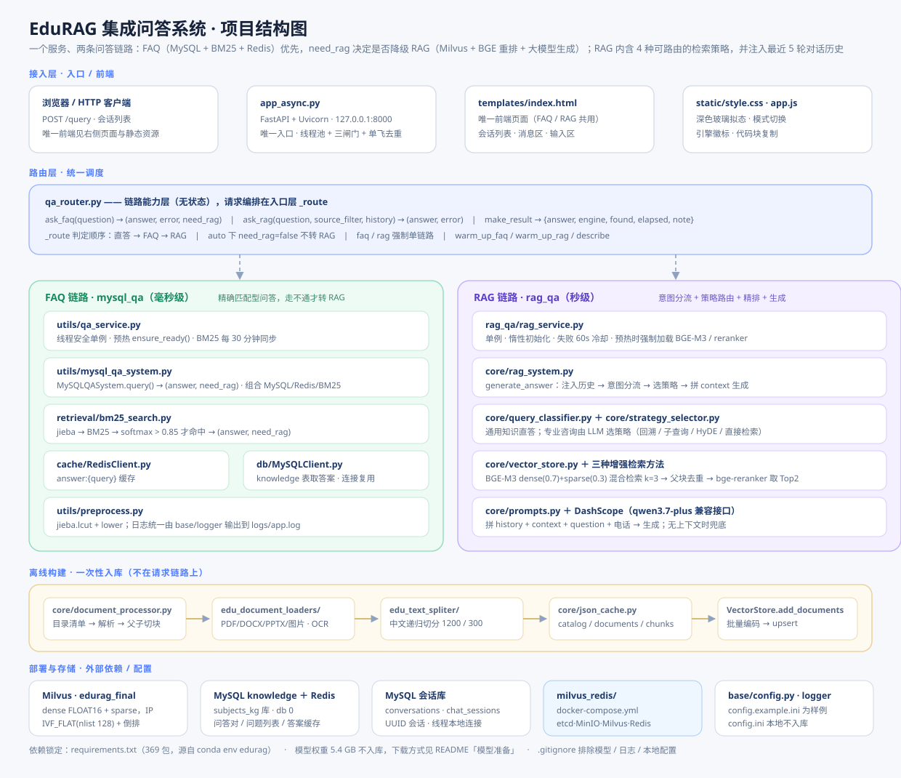
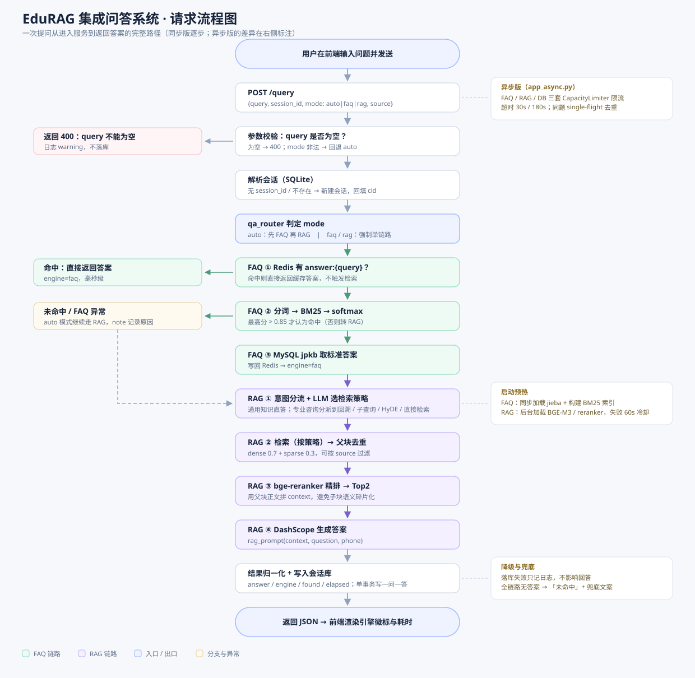

# EduRAG 集成问答系统 · 开发文档（详细版）

> 版本：v1.0　｜　最后更新：2026-10-22
> 适用范围：`integrated_qa_system/` 全目录
> 目标读者：接手本项目的开发者、需要排查线上问题的维护者

---

## 目录

1. [项目定位与能力边界](#1-项目定位与能力边界)
2. [技术栈与运行环境](#2-技术栈与运行环境)
3. [目录结构说明](#3-目录结构说明)
4. [配置项全解](#4-配置项全解)
5. [启动方式](#5-启动方式)
6. [接口契约](#6-接口契约)
7. [请求全链路拆解](#7-请求全链路拆解)
8. [FAQ 链路详解](#8-faq-链路详解)
9. [RAG 链路详解](#9-rag-链路详解)
10. [离线数据构建流水线](#10-离线数据构建流水线)
11. [会话存储设计](#11-会话存储设计)
12. [前端实现说明](#12-前端实现说明)
13. [并发、超时与性能](#13-并发超时与性能)
14. [错误处理与降级矩阵](#14-错误处理与降级矩阵)
15. [后续可添加与可修改](#15-后续可添加与可修改)
16. [扩展指南](#16-扩展指南)
17. [附录：类与方法索引](#17-附录类与方法索引)
18. [缓存体系：四级缓存对照](#18-缓存体系四级缓存对照)
19. [开发难点与优化实践](#19-开发难点与优化实践)

---

## 1. 项目定位与能力边界

本系统是一个**单服务、双链路**的教育领域问答系统。对外只暴露一套页面和一个问答接口，内部把两套异构的问答能力组合起来：

| 链路 | 数据来源 | 检索方式 | 生成方式 | 典型耗时 | 适用问题 |
|---|---|---|---|---|---|
| FAQ | MySQL `knowledge` 表 | jieba + BM25 打分 + softmax 归一化 + 阈值判定 | 无生成，直接取标准答案 | 毫秒级 | 与历史问题措辞接近的固定问答 |
| RAG | Milvus `edurag_final` 集合 | BGE-M3 dense + sparse 混合检索 → 父块去重 → bge-reranker 精排 | DashScope 大模型生成 | 秒级 | 需要跨段落归纳、推理、综述的问题 |

**核心设计约束：**

- 只有一个前端页面（`templates/index.html` + `static/`），FAQ 与 RAG 共用；原 `mysql_qa/templates`、`mysql_qa/static` 及 `mysql_qa/app.py`、`mysql_qa/app_async.py` 已移除。
- 只有一个路由判定入口（`qa_router.py`），Flask 同步版与 FastAPI 异步版必须共用同一份判定逻辑，禁止在入口文件里各写一套。
- RAG 属于**重资源**链路（显存、模型、外部 API），必须可失败、可降级，不能因为 Milvus 或大模型不可用导致整个服务不可用。

**默认路由策略（`mode=auto`）：**

```
用户提问
  └─ FAQ 检索（BM25 命中阈值 0.85）
       ├─ 命中 → (answer, need_rag=false) → 直接返回标准答案（engine=faq）
       ├─ 未命中 / 答案为空 / FAQ 异常 → (None, need_rag=true) → 转 RAG（engine=rag）
       │                                    └─ 仍无答案 → 兜底文案（engine=none）
       └─ 无效查询（need_rag=false 且无答案）→ 直接返回未命中，不触发 RAG
```

`need_rag` 是 FAQ 链路对外暴露的唯一调度信号：`BM25Search.search()` → `MySQLQASystem.query()` → `qa_router.ask_faq()` 逐层透传该标志，路由层据此决定是否降级。这样把「为什么没答出来」和「要不要继续花钱检索」拆成两件事——空查询、非法输入不会白跑一次 BGE + 大模型。

`mode=faq` 与 `mode=rag` 用于强制单链路，便于压测、排障和效果对照。

---

## 2. 技术栈与运行环境

### 2.1 语言与框架

| 层 | 组件 | 版本（edurag 环境实测） |
|---|---|---|
| 语言 | Python | 3.12.14（conda-forge，字节码缓存为 cpython-312） |
| 同步服务 | Flask | `3.1.3` |
| 异步服务 | FastAPI + Uvicorn | `0.143.0` / `0.54.0` |
| 异步线程池 | anyio | `4.15.1` |
| 模板 | Jinja2 | `3.1.6` |
| 稀疏检索 | rank-bm25 | `0.2.2` |
| 中文分词 | jieba | `0.42.1` |
| 向量库 | pymilvus | `3.0.2` |
| 向量模型 | milvus-model（BGE-M3） | `0.2.12` |
| 精排模型 | sentence-transformers | `6.1.0` |
| 深度框架 | torch / torchvision / transformers | `2.7.1+cu126` / `0.22.1+cu126` / `5.17.0` |
| 大模型客户端 | openai（OpenAI 兼容协议） | `3.16.2` |
| 关系库 | PyMySQL | `1.2.3` |
| 缓存 | redis | `8.1.0` |
| 文档解析 | python-docx / python-pptx / pymupdf / opencv / rapidocr | `1.2.0` / `1.0.2` / `1.28.2` / `5.0.0.93` / `1.4.4` |
| 文本切分 | langchain / langchain-core / text-splitters | `1.4.4` / `1.6.9` / `1.1.3` |
| Milvus 集成 | langchain-milvus / langchain-community | `0.4.0` / `0.4.2` |

> 版本以 conda 环境 `edurag`（`E:/ProgramData/anaconda3/envs/edurag`）为准，完整清单见该环境目录下的 `requirements.txt`
> （`pip freeze` 导出，共 371 个包）。仓库根目录的 `requirements.txt` 为早期手写版本，部分版本号已过期。

### 2.2 外部依赖（必须先就绪）

| 依赖 | 地址 | 用途 | 不可用时的表现 |
|---|---|---|---|
| MySQL | `localhost:3306`，库 `subjects_kg`，表 `knowledge` | FAQ 标准问答对 | FAQ 链路抛异常 → auto 模式转 RAG；faq 模式返回兜底文案 |
| Redis | `localhost:6379`，db 0 | 问题列表 + 答案缓存 | FAQ 初始化失败 → 同上 |
| Milvus | `localhost:19530`，库 `test5`，集合 `edurag_final` | 向量检索 | RAG 初始化失败 → `note` 记录原因，返回未命中 |
| DashScope | config.ini 中的 base_url | 检索策略选择 + 答案生成 | RAG 生成失败 → 返回未命中并记录日志 |

> Milvus 与 Redis 可用仓库内的 `milvus_redis/docker-compose.yml` 一键启动（含 etcd、MinIO），
> 启动方式、端口/密码对应关系与可修改项见 `milvus_redis/README.md`。

### 2.3 模型文件（`rag_qa/models/`，合计约 5.4 GB）

| 目录 | 用途 | 加载时机 |
|---|---|---|
| `bge-m3` | 混合检索的 dense + sparse 编码 | 首次检索 / 预热时 |
| `bge-reranker-large` | 精排（CrossEncoder） | 首次检索且候选 ≥ 2 时 |
| `bert-base-chinese` | 意图分类的底座模型 | 初始化 `QueryClassifier` 时 |
| `bert_query_classifier` | 意图分类微调权重 | 初始化 `QueryClassifier` 时（路径已修正为 `models/bert_query_classifier`） |
| `nlp_bert_document-segmentation_chinese-base` | 文档语义分割（备用） | 仅在 `edu_model_text_spliter` 被使用时 |

> 显存估算：BGE-M3(fp16) ≈ 1.1 GB + reranker-large ≈ 1.3 GB + BERT ≈ 0.4 GB，8 GB 显卡可容纳。RAG 并发越高，峰值显存与延迟越高，见 §13。

### 2.4 LangChain 技术栈：用在哪、不用在哪

LangChain 在本项目里承担的是**基础抽象层**（提示词模板、文档对象、加载器接口、文本切分），不是编排框架。版本：`langchain 1.4.4` / `langchain-core 1.6.9` / `langchain-community 0.4.2` / `langchain-text-splitters 1.1.3`。

| 用到的 API | 代码位置 | 承担的工作 |
|---|---|---|
| `langchain_core.prompts.PromptTemplate` | `core/prompts.py`（4 个模板）、`core/strategy_selector.py`（策略模板） | 提示词变量化，`input_variables` 声明 + `format()` 填充；空值不会自动转义（`None` 会被渲染成字符串 `"None"`） |
| `langchain_core.documents.Document` | `core/vector_store.py`、`core/document_processor.py`、4 个 OCR 加载器 | 统一文档载体：`page_content` + `metadata`（`parent_id` / `parent_content` / `source` / `timestamp` / `child_id`） |
| `langchain_core.document_loaders.BaseLoader` | `edu_document_loaders/*` | 自定义 PDF/DOCX/PPTX/IMG 加载器继承的基类，统一 `lazy_load()` 契约 |
| `langchain_text_splitters.RecursiveCharacterTextSplitter` | `edu_chinese_recursive_text_splitter.py` | 中文递归切分（父块 1200 / 子块 300 / 重叠 50） |
| `langchain_text_splitters.CharacterTextSplitter` | `edu_model_text_spliter.py` | 基于语义分割的备选切分器（当前未启用） |
| `langchain_community.document_loaders.TextLoader` | `document_processor.LOADER_REGISTRY['.txt']` | `.txt` 直接读文本，按需 import |

**没有使用的部分（事实边界）：**

| 未使用的能力 | 现状 |
|---|---|
| LCEL / `Runnable` / Chain / Agent / Memory | 路由、检索、生成都是手写函数组合；策略分派用 `self.tools` 字典 |
| `Retriever` 抽象 | 直接调 pymilvus 的 `AnnSearchRequest` + `WeightedRanker` + `hybrid_search` |
| `langchain-milvus` / `langchain-openai` / `langchain-ollama` | 环境里已安装，代码未引用 |
| `ChatOpenAI` 等模型封装 | 用 `openai` SDK 直连 DashScope 兼容接口，自建 `call_llm` |

**取舍理由：** 混合检索需要直接控制 dense / sparse 两路 `AnnSearchRequest`、`WeightedRanker(0.7, 0.3)` 与父块去重，走 LangChain Retriever 要额外写适配层；而 Prompt 模板与 `Document` 对象恰好是 LangChain 最稳定、最省代码的部分，因此只在这两层引入。

---

## 3. 目录结构说明



```
integrated_qa_system/
├── app.py                     # Flask 同步入口（:5000）
├── app_async.py               # FastAPI 异步入口（:8000）
├── qa_router.py               # 统一路由：FAQ 优先 + RAG 兜底
├── config.example.ini         # 脱敏配置样例（config.ini 需自行复制并填 Key）
├── requirements.txt           # 依赖锁定（371 个包）
├── .gitignore                 # 排除模型权重 / 日志 / 会话库 / 本地配置
├── templates/
│   └── index.html             # 唯一前端页面
├── static/
│   ├── style.css              # 深色玻璃拟态样式
│   └── app.js                 # 会话管理 / 模式切换 / 渲染
├── milvus_redis/              # 本地依赖环境
│   ├── docker-compose.yml     # Milvus standalone + etcd + MinIO + Redis
│   └── README.md              # 启动、端口对应、可修改项、常见问题
├── readme/                    # 本文档所在目录
│   ├── 开发文档-详细版.md
│   ├── 开发文档-简略版.md
│   ├── architecture.svg
│   └── flow.svg
├── base/                      # 基础设施层
│   ├── config.py              # Config：集中读取 config.ini
│   ├── logger.py              # 单例 logger（文件 + 控制台）
│   └── __init__.py            # 对外暴露 Config / logger
├── logs/
│   └── app.log                # 运行日志（追加写）
├── mysql_qa/                  # FAQ 能力包（纯后端，无入口无前端）
│   ├── __init__.py            # 包说明（不做聚合导出）
│   ├── utils/                 # __init__.py 零副作用，不导出 preprocess_text
│   │   ├── qa_service.py      # 单例 + 预热
│   │   ├── mysql_qa_system.py # MySQLQASystem 组合器
│   │   ├── chat_store.py      # SQLite 会话存储
│   │   └── preprocess.py      # 文本预处理（jieba 延迟导入）
│   ├── retrieval/             # __init__.py 导出 BM25Search
│   │   └── bm25_search.py
│   ├── db/                    # __init__.py 导出 MySQLClient
│   │   └── MySQLClient.py
│   ├── cache/                 # __init__.py 导出 RedisClient
│   │   └── RedisClient.py
│   └── data/
│       ├── JP_Knowledge.csv   # 初始问答语料
│       └── chat_history.db    # 会话数据库（WAL）
└── rag_qa/                    # RAG 能力包
    ├── __init__.py            # 包说明（不做聚合导出）
    ├── rag_service.py         # 单例 + 失败冷却 + 预热
    ├── rag_main.py            # 命令行入口（建库 / 交互查询）
    ├── core/                  # __init__.py 刻意留空：避免 import 时拉起 torch
    │   ├── rag_system.py      # RAGSystem：分类 → 策略 → 检索 → 生成
    │   ├── vector_store.py    # Milvus 封装：混合检索 + rerank
    │   ├── document_processor.py # 目录扫描 + 解析 + 父子切块
    │   ├── json_cache.py      # 三级 JSON 缓存
    │   ├── query_classifier.py# BERT 意图分类（含训练代码）
    │   ├── strategy_selector.py# LLM 选择检索策略
    │   └── prompts.py         # 4 个 Prompt 模板
    ├── edu_document_loaders/  # PDF/DOCX/PPTX/图片 OCR 加载器（内部相对导入）
    ├── edu_text_spliter/      # 中文递归切分器（只导出轻量的 ChineseRecursiveTextSplitter）
    ├── models/                # 模型权重（5.4 GB，不入版本库）
    └── data/                  # 语料 + .cache/ 缓存
```

**分层关系（自上而下单向依赖）：**

```
入口层（app.py / app_async.py）
   ↓
路由层（qa_router.py）
   ↓
能力层（mysql_qa/utils、rag_qa/rag_service）
   ↓
组件层（BM25 / MySQL / Redis / Milvus / LLM）
   ↓
基础层（base/config.py、base/logger.py）
```

**禁止的反向依赖：** 能力层不得 import 入口层；组件层不得 import 路由层。入口层只准 import `qa_router`、`base`、`mysql_qa.utils.chat_store` 三处，不允许直接碰 BM25 / VectorStore 等细节。

### 3.1 包与导入约定

`mysql_qa/` 与 `rag_qa/` 下每一层都有 `__init__.py`，全项目统一为「**包内相对、跨包绝对**」：

| 场景 | 写法 | 原因 |
|---|---|---|
| 同包兄弟模块 | `from .prompts import RAGPrompts`<br>`from ..cache import RedisClient` | 不依赖 `sys.path` 顺序，也不会与顶层同名模块串包 |
| 跨包引用本项目的包 | `from rag_qa.core.vector_store import VectorStore`<br>`from mysql_qa.db import MySQLClient` | 以项目根为锚，路径可搜索 |
| 基础层 | `from base import Config, logger` | `base` 是顶层包，只能绝对导入 |
| 三方依赖 | `import torch` / `from flask import ...` | 不变 |

配套规则：

1. **只有入口层允许改 `sys.path`**，且只插入项目根：`app.py`、`app_async.py`、`qa_router.py`、`rag_qa/rag_main.py`。库模块内不再出现 `sys.path.insert`。
2. **子包用 `__init__.py` 做 re-export**，调用方不必记文件名：`from mysql_qa.db import MySQLClient`、`from mysql_qa.retrieval import BM25Search`、`from rag_qa.edu_document_loaders import OCRPDFLoader`。
3. **包入口不做聚合导出**。`rag_qa/__init__.py`、`rag_qa/core/__init__.py`、`mysql_qa/__init__.py`、`mysql_qa/utils/__init__.py` 都只有说明性注释——因为这些包里混着「轻模块」与「重模块」（`query_classifier` 顶层 `import torch`、`retrieval` 拉起 jieba、`edu_model_text_spliter` 拉起 modelscope）。一旦在 `__init__` 里 re-export，`from rag_qa.core.json_cache import ...` 这种轻量导入也会被拖慢，惰性加载的设计就失效了。
4. **动态导入同步改包路径**。`document_processor.LOADER_REGISTRY` 里用的是字符串模块名，已从 `edu_document_loaders` 改为 `rag_qa.edu_document_loaders`；改包结构时这类字符串最容易漏。
5. **`utils` 包保持零副作用**：`mysql_qa/utils/__init__.py` 不导出 `preprocess_text`，否则 `from mysql_qa.utils import chat_store`（纯 sqlite3）也会连带加载 jieba。

> 运行方式：包内脚本推荐 `python -m rag_qa.core.document_processor`，单文件直接执行会因相对导入找不到父包而失败；`python rag_qa/rag_main.py` 与 `python app.py` 仍可直接运行。

---

## 4. 配置项全解

所有配置集中在 `config.ini`，由 `base/config.py` 的 `Config` 类统一读取并做类型转换。

> 仓库只提交脱敏的 `config.example.ini`：`config.ini` 含 LLM API Key，已列入 `.gitignore`。克隆后先 `cp config.example.ini config.ini` 再填写自己的 Key；`api_key`（旧键名 `dashscope_api_key`）与 `customer_service_phone` 没有默认值，缺失会导致 `Config()` 抛异常。`Config` 每次实例化都会重新读文件，实际使用中多处以模块级 `conf = Config()` 缓存。

| 段 | 键 | 默认回退值 | 当前值 | 影响 |
|---|---|---|---|---|
| `[mysql]` | `host` | localhost | localhost | FAQ 数据源 |
| | `user` | root | root | |
| | `password` | mysql | 123 | |
| | `database` | subjects_kg | subjects_kg | 表名固定 `knowledge` |
| `[redis]` | `host` | localhost | localhost | 缓存 + 问题列表 |
| | `port` | 6379 | 6379 | |
| | `password` | 1234 | 1234 | 为空时需改为 `""` |
| | `db` | 0 | 0 | |
| `[logger]` | `log_file` | `<BASE_DIR>/logs/app.log` | 已注释 → 用默认 | 日志落盘位置 |
| `[milvus]` | `host` / `port` | localhost / 19530 | localhost / 19530 | 向量库连接 |
| | `database_name` | itcast | test5 | 注意与集合所在库一致 |
| | `collection_name` | edurag_final | edurag_final | 集合不存在会自动建 |
| `[llm]` | `model` | qwen-plus | qwen3.7-plus | 生成与策略选择 |
| | `api_key` | 无回退（缺失即报错）；可回退旧键 `dashscope_api_key` | sk-ws-…（建议改环境变量） | 供应商鉴权 |
| | `base_url` | 回退 `dashscope_base_url` → 阿里云正式地址 | 私有 ws 网关 | OpenAI 兼容地址 |
| | `timeout` | 60 | 60 | 单次生成超时（秒） |
| | `web_search` | auto | auto | 是否发送 `enable_search`，仅 DashScope 支持 |
| `[cache]` | `cache_dir` | `rag_qa/data/.cache` | 已注释 → 用默认 | 三级缓存目录 |
| | `verify_files` | False | False | True 时逐文件 stat 校验 |
| | `chunks` | True | True | 是否启用切块缓存 |
| `[retrieval]` | `parent_chunk_size` | 1200 | 1200 | 父块字符数 |
| | `child_chunk_size` | 300 | 300 | 子块字符数 |
| | `chunk_overlap` | 50 | 50 | 重叠字符数 |
| | `retrieval_k` | 5 | 3 | 混合检索召回条数 |
| | `candidate_m` | 2 | 2 | 精排后喂给 LLM 的父块数 |
| `[app]` | `valid_sources` | `["ai","java","test","ops","bigdata"]` | 同默认 | 前端学科下拉 + Milvus `source` 过滤值 |
| | `customer_service_phone` | 无回退（缺失即报错） | 12345678 | 兜底话术里的电话 |

> 两个**没有 fallback** 的键：`api_key`（旧键名 `dashscope_api_key` 亦可）、`customer_service_phone`。删掉它们 `Config()` 会直接抛 `NoOptionError`，注意不要误删。

### 4.1 模型供应商选择（OpenAI 兼容，按延迟取舍）

检索与重排都在本地完成，只有「生成」这一步依赖外部大模型。项目全程只用 OpenAI 兼容协议（`openai` SDK + `base_url`），所以**换供应商是改配置，不是改代码**。

| 供应商 | `base_url` | `model` 示例 | 典型首 token | 适用场景 |
|---|---|---|---|---|
| 阿里云 DashScope | `https://dashscope.aliyuncs.com/compatible-mode/v1` | `qwen-plus` / `qwen3.7-plus` | 0.3 ~ 1 s（国内） | 国内部署、需要联网搜索 |
| DeepSeek 官方 | `https://api.deepseek.com/v1` | `deepseek-chat` / `deepseek-reasoner` | 0.5 ~ 2 s | 成本敏感、答案质量优先 |
| 本地 vLLM | `http://127.0.0.1:8000/v1` | `Qwen/Qwen2.5-7B-Instruct` | 0.3 ~ 0.8 s（4060 + 7B-AWQ） | 数据不出内网、无请求费用 |
| Ollama / LM Studio / OneAPI | `http://127.0.0.1:11434/v1` 等 | `qwen2.5:7b` | 0.5 ~ 2 s | 本机调试、快速换模型 |

本地 vLLM 启动方式（OpenAI 兼容服务，端口对齐 `base_url`）：

```bash
python -m vllm.entrypoints.openai.api_server \
    --model Qwen/Qwen2.5-7B-Instruct \
    --port 8000 \
    --dtype auto
```

**三个容易踩的坑**：

1. `api_key` 必须非空。本地 vLLM / Ollama 没有鉴权，但 OpenAI SDK 会校验，填 `EMPTY` 即可。
2. `extra_body={"enable_search": True}` 是 DashScope 专有参数，DeepSeek / vLLM 带上会直接 400。因此新增 `[llm] web_search`：`auto` 时仅当 `base_url` 指向 DashScope 才发送，也可用 `on` / `off` 强制。
3. `model` 必须与供应商侧完全一致；vLLM 要写启动时的 `--model` 全名（含组织前缀），不能写缩写。

**怎么按延迟选**：用 `loadtest/bench_qa.py` 压一轮，比较 **P95** 而不是平均值——云端供应商的尾延迟受网络抖动影响大，本地 vLLM 更稳定但吞吐受显存限制。另外并发超过 `RAG_CONCURRENCY=2` 时本地模型会排队，反而可能比云端更慢。

**显存账必须先算清楚**（这一点最容易翻车）：RAG 链路的 BGE-M3（约 2.2 GB）与 bge-reranker-large（约 1.3 GB）常驻 GPU，两者合计约 3.5 GB。留给生成模型的余量因此比显卡标称值小得多：

| 显卡 | 留给 vLLM 的余量 | 建议模型 |
|---|---|---|
| 8 GB（4060 Laptop） | ~4.5 GB | Qwen2.5-**3B**-Instruct AWQ（~2 GB）；7B-AWQ 会 OOM |
| 16 GB | ~12 GB | 7B fp16 或 14B-AWQ |
| 24 GB | ~20 GB | 14B fp16 / 32B-AWQ |

显存不够时有三条路：换更小的模型、把 embedding / reranker 挪到 CPU（延迟上升 3~5 倍）、或直接继续用云端供应商。实测 8 GB 卡上「BGE-M3 + reranker + 7B-AWQ」会 OOM，这是选择本地部署前最该先确认的一件事。

---

## 5. 启动方式

### 5.1 前置检查

```bash
# 1) 外部服务
mysql -uroot -p -e "select count(*) from subjects_kg.knowledge;"
redis-cli -a 1234 ping
# Milvus: http://localhost:9091/healthz

# 2) 模型目录（5.4 GB）
ls rag_qa/models/bge-m3 rag_qa/models/bge-reranker-large

# 3) 依赖
pip install -r requirements.txt
```

### 5.2 同步版（Flask）

```bash
cd integrated_qa_system
python app.py            # → http://127.0.0.1:5000
```

启动过程：`warm_up_faq()` 同步执行（jieba 初始化 + BM25 建索引）→ `warm_up_rag(in_background=True)` 起后台线程 → 绑定端口。`use_reloader=False`，因为 reloader 会导致 BM25、Milvus 连接与后台同步线程被初始化两次。

### 5.3 异步版（FastAPI）

```bash
cd integrated_qa_system
python app_async.py                      # → http://127.0.0.1:8000
# 或
uvicorn app_async:app --host 127.0.0.1 --port 8000
```

支持的运行时环境变量：

| 变量 | 默认 | 说明 |
|---|---|---|
| `PORT` | 8000 | 监听端口 |
| `FAQ_CONCURRENCY` | `max(4, CPU 核数)` | FAQ 线程池闸门 |
| `RAG_CONCURRENCY` | 2 | RAG 线程池闸门（显存/算力受限） |
| `DB_CONCURRENCY` | 32 | SQLite 操作闸门 |
| `FAQ_TIMEOUT` | 30 | 单次 FAQ 检索超时（秒） |
| `RAG_TIMEOUT` | 180 | 单次 RAG 生成超时（秒） |

### 5.4 命令行模式（不入服务，用于建库与调试）

```bash
cd integrated_qa_system
python -m rag_qa.rag_main          # 交互式查询（需 Milvus + LLM）
python -c "from rag_qa.rag_main import main; main(query_mode=False, directory_path='rag_qa/data/test_data')"
```

`main(query_mode=False, ...)` 会遍历 `directory_path/{source}_data` 逐目录解析、切块并写入 Milvus；`query_mode=True` 进入命令行问答循环。

---

## 6. 接口契约

所有接口返回 JSON `code=0` 表示成功；错误统一返回 `code` + `message`（HTTP 状态码同步设置）。

### 6.1 `POST /query` —— 统一问答

**请求**

```json
{
  "query": "AI 学科的课程大纲是什么",
  "session_id": 3,
  "mode": "auto",
  "source": "ai"
}
```

| 字段 | 必填 | 说明 |
|---|---|---|
| `query` | 是 | 问题文本，去空白后不能为空 |
| `session_id` | 否 | 不存在或非法则自动新建会话 |
| `mode` | 否 | `auto`（默认）/ `faq` / `rag`；非法值回退 `auto` |
| `source` | 否 | 学科过滤，仅对 RAG 生效；取值见 `VALID_SOURCES` |

**成功响应**

```json
{
  "code": 0,
  "message": "ok",
  "session_id": 3,
  "title": "AI 学科的课程大纲是什么",
  "query": "AI 学科的课程大纲是什么",
  "answer": "……",
  "found": true,
  "engine": "rag",
  "elapsed": 3.2145,
  "note": "FAQ 无可靠答案，已转 RAG"
}
```

| 字段 | 说明 |
|---|---|
| `engine` | `faq` / `rag` / `none`，表示真正产出答案的链路 |
| `found` | 是否拿到非空答案；`false` 时 `answer` 为兜底文案 |
| `elapsed` | 链路内部计时（秒，四位小数），不含网络与序列化 |
| `note` | 过程说明，前端作为悬浮提示展示（如"FAQ 异常（FAQ 服务异常: …），已转 RAG"） |

**错误响应**

| 场景 | HTTP | code | 说明 |
|---|---|---|---|
| `query` 为空 | 400 | 400 | 不落库 |
| 路由/检索抛未捕获异常 | 500 | 500 | 已建会话仍会返回 `session_id` |
| 异步版单链路超时 | 200 | 0 | 不返回 504，而是在 `note` 中说明超时并给兜底文案 |

> 说明：同步版在 `answer_query` 抛出未捕获异常时返回 500；异步版在 `_route` 内部已捕获链路异常，只在极端情况下才 500。

### 6.2 其余接口

| 方法 | 路径 | 说明 |
|---|---|---|
| GET | `/` | 返回唯一页面（Jinja 渲染 `templates/index.html`） |
| GET | `/api/meta` | `{code, modes, sources, engines}`，前端初始化用 |
| GET | `/api/conversations` | 会话列表（按 `updated_at` 倒序，最多 100 条） |
| POST | `/api/conversations` | 新建会话，body 可选 `{"title": "..."}`，返回 201 |
| GET | `/api/conversations/{id}` | 单个会话 + 全部消息 |
| PATCH | `/api/conversations/{id}` | 重命名，body `{"title": "..."}` |
| DELETE | `/api/conversations/{id}` | 删除会话及其消息 |
| GET | `/health` | 健康检查；异步版额外返回各闸门 `borrowed_tokens` / `tasks_waiting` |

---

## 7. 请求全链路拆解



### 7.1 同步版逐步（`app.py`）

1. **进入视图**：`POST /query` → 同时兼容 JSON 与表单（`request.get_json(silent=True) or request.form`）。
2. **参数校验**：`query.strip()` 为空 → 直接 400。
3. **会话解析**：`_resolve_conversation(session_id)`；`session_id` 非法或查不到 → `chat_store.create_conversation()` 新建。
4. **路由**：`answer_query(question, mode, source_filter, conversation_id)`；内部先 FAQ 后 RAG（详见 §8、§9）。传入的 `conversation_id` 只在转入 RAG 时用于取历史。
5. **结果归一化**：`found = bool(answer)`；未命中用 `NO_ANSWER_TEXT` 兜底。
6. **生成 meta**：`FAQ · 耗时 0.0123 s` / `RAG · 耗时 3.2145 s` / `未命中 · 耗时 0.0123 s`，用于历史消息还原引擎徽标。
7. **落库**：`chat_store.add_exchange(cid, question, answer, meta)` 单事务写入两条消息并刷新会话时间；失败只记日志，不影响响应。
8. **响应**：返回 §6.1 的 JSON。

### 7.2 异步版逐步（`app_async.py`）

与同步版差异集中在"阻塞调用的执行方式"：

1. 事件循环只处理 I/O；FAQ（jieba / BM25 / MySQL / Redis）、RAG（Milvus / BGE / LLM）、SQLite 全部 `run_sync` 到线程池。
2. 三套独立闸门：`faq_limiter`、`rag_limiter`、`db_limiter`；线程池总容量被设置为三者之和 + 8。
3. 每条链路单独 `asyncio.wait_for` 超时（FAQ 30 s / RAG 180 s），超时后返回兜底答案并在 `note` 标记。
4. **single-flight 去重**：key = `(question, mode, source, conversation_id)`；同一时刻相同 key 只真正执行一次，其余请求 `await` 同一个 Future。请求被取消不影响底层计算。**会话必须进 key**：RAG 会按会话注入历史，同一问题在不同会话里的答案可能不同，跨会话复用会串味。
5. 启动预热：`await run_sync(warm_up_faq)` 同步完成 FAQ 预热；`warm_up_rag(in_background=True)` 起后台线程加载模型。

### 7.3 关键时序（auto 模式未命中）

```
客户端 → POST /query
服务端 → chat_store.get_conversation(cid)            [SQLite, ms]
       → ask_faq(question)
            → Redis GET answer:{query}                [ms]
            → jieba.lcut + BM25.get_scores + softmax  [ms]
            → score ≤ 0.85 → (None, need_rag=true)
       → chat_store.recent_history(cid, turns=5)      [SQLite, ms]
       → ask_rag(question, source_filter, history)
            → QueryClassifier.predict_category        [GPU, ms]
            → LLM 选策略（回溯/子查询/HyDE/直接）        [LLM, 1~3 s]
            → VectorStore.hybrid_search_with_rerank   [GPU, 0.2~1 s]
            → 拼 history + context → LLM 生成答案      [LLM, 2~10 s]
       → chat_store.add_exchange(...)                 [SQLite, ms]
客户端 ← {engine: "rag", elapsed: 3.2, note: "FAQ 无可靠答案，已转 RAG"}
```

---

## 8. FAQ 链路详解

调用链：`qa_router.ask_faq` → `mysql_qa.utils.qa_service.get_qa_system` → `MySQLQASystem.query` → `BM25Search.search`。

### 8.1 单例与预热

`mysql_qa/utils/qa_service.py`

```python
get_qa_system()  # 双重检查锁（threading.Lock），首次调用构造 MySQLQASystem
ensure_ready()   # jieba.initialize() + get_qa_system()
```

`MySQLQASystem.__init__` 依次构造 `MySQLClient` → `RedisClient` → `BM25Search`。因此 **FAQ 的可用性 = MySQL + Redis 同时可用**。

### 8.2 BM25 索引的生命周期

`BM25Search.__init__`：

- 立即执行一次 `sync_from_mysql()`：`select question from knowledge` → jieba 分词 → 覆盖写 Redis 两个键 → `BM25Okapi(tokenized)`。
- 起一个 daemon 线程，每 `30 * 60` 秒重新同步一次（配置写死在代码里，不是 config.ini 项）。
- `_sync_lock` 保证手动同步与定时同步不并发。

Redis 键约定：

| Key | 内容 |
|---|---|
| `qa_original_questions` | 原始问题字符串列表 |
| `qa_tokenized_questions` | 对应的分词结果（二维列表） |
| `answer:{query}` | 单条问题的答案缓存（JSON 序列化） |

> 注意：Redis 中的问题列表目前**只写不读**，`search()` 全程使用内存里的 `self.original_questions` 与 `self.bm25`。Redis 在这里的实际作用是答案缓存 + 跨进程共享的中间产物。

### 8.3 打分与命中判定

```python
tokenizer = jieba.lcut(query)
scores = bm25.get_scores(tokenizer)          # 每个历史问题一个 BM25 分
probs  = softmax(scores)                     # 减 max 后取 exp，再归一化
best   = argmax(probs); score_max = probs[best]
if score_max > 0.85:
    answer = mysql.fetch_answer(original_questions[best])
    if not answer:                           # 命中问题但答案为空
        return None, True                    # 不写缓存，交回路由层转 RAG
    redis.set_data(f"answer:{query}", answer)
    return answer, False
return None, True
```

返回值统一为 `(answer, need_rag)`。判空必须在 `set_data` 之前——否则空答案会被缓存下来，后续同一查询会一直命中空值。

`softmax` 归一化的含义：**最高分相对"全部问题的分数总和"的占比**。问题库越大、分布越平，最高分越难超过 0.85；因此这个阈值与语料规模强相关，扩库后需要重新标定（见 §15.1）。

### 8.4 完整判定顺序

1. `query` 为空 → 返回 `(None, False)`：不需要检索，也不需要 RAG。
2. Redis `answer:{query}` 命中 → 返回 `(answer, False)`（不再计算 BM25）。
3. BM25 最高分 ≤ 0.85 → 返回 `(None, True)`（→ 路由层转 RAG）。
4. 命中但 `fetch_answer` 返回空 → 返回 `(None, True)`，不写缓存。
5. 命中且答案非空 → 用最相似的历史问题去 MySQL 取答案 → 写缓存 → 返回 `(answer, False)`。

### 8.5 数据模型

```sql
-- subjects_kg.knowledge
CREATE TABLE knowledge (
  id INT AUTO_INCREMENT PRIMARY KEY,
  subject_name VARCHAR(100),
  question     VARCHAR(1000),
  answer       VARCHAR(5000)
);
```

初始化数据在 `mysql_qa/data/JP_Knowledge.csv`（列名：学科名称 / 问题 / 答案），通过 `MySQLClient.insert_data(csv_path)` 导入。

#### 8.5.1 分区表（可选：单学科数据量很大时）

`knowledge` 目前是单表、467 行，这个规模完全不需要分区。但如果某个学科的知识对（question / answer 都是长文本）涨到几十万行以上，全表扫描与二级索引的成本会明显上升，此时才值得按学科分区。

MySQL 的硬约束：**分区表的所有主键 / 唯一键都必须包含分区列**，因此主键要从 `(id)` 调整为 `(id, subject_name)`。

学科封闭（ai / java / test / ops / bigdata 固定不变）用 LIST COLUMNS，每个学科一个分区：

```sql
CREATE TABLE knowledge (
  id           INT NOT NULL AUTO_INCREMENT,
  subject_name VARCHAR(100) NOT NULL,
  question     VARCHAR(1000) NOT NULL,
  answer       VARCHAR(5000),
  PRIMARY KEY (id, subject_name),
  KEY idx_subject (subject_name)
) ENGINE=InnoDB DEFAULT CHARSET=utf8mb4
PARTITION BY LIST COLUMNS (subject_name) (
  PARTITION p_ai      VALUES IN ('ai'),
  PARTITION p_java    VALUES IN ('java'),
  PARTITION p_test    VALUES IN ('test'),
  PARTITION p_ops     VALUES IN ('ops'),
  PARTITION p_bigdata VALUES IN ('bigdata')
);
```

注意 LIST COLUMNS 的代价：写入未列出的学科值会直接失败（`Table has no partition for value`），新增学科必须 `ALTER TABLE knowledge ADD PARTITION (...)`。学科会持续新增时改用 KEY 分区，它会按哈希自动分散，不用维护分区清单：

```sql
PARTITION BY KEY (subject_name) PARTITIONS 8;
```

**分区不等于加速**：收益前提是查询能裁剪分区。当前 BM25 索引是启动时全量 `select question from knowledge`，不带学科条件，分区只能减少物理扫描的碎片、无法裁剪分区。真正受益的是「按学科过滤的检索」——即带 `where subject_name = ?` 的查询。若走的是全量加载 + 内存 BM25 的路线，优先考虑的是把全量加载改成按学科分片加载，而不是先上分区。

### 8.6 连接管理

- `MySQLClient`：单连接 + `threading.Lock` 串行化；**没有重连机制**，MySQL 重启后进程内的连接会失效，需要重启服务（见 §15.2）。
- `RedisClient`：`StrictRedis(decode_responses=True)`；`set_data` / `get_answer` 均 try/except 吞掉异常并记日志。

---

## 9. RAG 链路详解

调用链：`qa_router.ask_rag` → `rag_qa.rag_service.answer` → `RAGSystem.generate_answer`。

### 9.1 单例、失败冷却与预热

`rag_qa/rag_service.py`

- `get_rag_system()`：双重检查锁；构造 `VectorStore`（连接 Milvus、`load_collection`）→ 构造 LLM 调用函数 → 构造 `RAGSystem`（加载 BERT 分类器）→ **强制触发** `embedding_function` 与 `reranker` 的懒加载，把 BGE 权重真正读进显存。
- 初始化失败：记录 `_failure_reason` 与时间戳，**60 秒内快速失败**，避免每个请求都重连 Milvus 拖住线程。
- `ensure_ready()`：预热入口，异常不外抛，只返回 False。

### 9.2 生成流程（`RAGSystem.generate_answer`）

```
1. history_context = _build_history_context(history)             # 最近 5 轮，含长度预算
2. classified_query = QueryClassifier.predict_category(query)    # 加载 models/bert_query_classifier 微调权重
3. 「通用知识」→ rag_prompt.format(context="", history) → self.llm(...) 直接作答后返回
4. 「专业咨询」→ strategy_prompt_template.format(query) → self.llm(...) → strategy.strip()
5. retrieve_and_merge(query, source_filter, strategy) 按策略四选一：
       ├─ 「回溯问题检索」→ _retrieve_with_backtracking
       ├─ 「子查询检索」  → _retrieve_with_subqueries
       ├─ 「假设问题检索」→ _retrieve_with_hyde
       └─ 其余取值（含「直接检索」）→ vector_store.hybrid_search_with_rerank
6. context = "\n".join(doc.page_content for doc in docs)（无文档时为空串）
7. rag_prompt.format(context, history, question, phone) → self.llm(...) → answer
```

实现要点：

- 分类结果不再被硬编码覆盖，「通用知识」分支已可达；专业咨询才进入检索增强流程。
- 策略由 LLM 给出，代码用 `self.tools.get(strategy, self.tools["直接检索"])` 取方法：模型输出带引号或解释文字时字典取不到，自动退化为「直接检索」，请求不会中断（`strategy.strip()` 只清理首尾空白，但去与不去直接决定能否命中字典 key，因此必须保留）。
- `retrieve_and_merge(strategy=None)` 直接返回 `[]`，避免空策略继续检索。
- 策略分派走 `self.tools` 字典（策略名 → 方法）：`retrieve_and_merge` 用 `self.tools.get(strategy, self.tools["直接检索"])` 取方法后统一调用；旧的 if/elif 分支已注释保留。

### 9.2.1 对话历史注入

`history` 由路由层从 `chat_store.recent_history(cid, turns=5)` 取得，元素形如 `{"question": "...", "answer": "..."}`。`_build_history_context` 负责把它变成提示词片段：

| 约束 | 取值 | 作用 |
|---|---|---|
| 轮数 | `HISTORY_TURNS = 5` | 只带最近 5 轮，避免上下文淹没当前问题 |
| 单条长度 | `HISTORY_ITEM_MAX_CHARS = 200` | 多行压成单行后截断，防止长答案撑爆 prompt |
| 总预算 | `HISTORY_MAX_CHARS = 1500` | 从最近一轮往前累加，超预算即停，优先保住最新对话 |

容错：`history` 不是 list、元素不是 dict、缺 `question`/`answer`、内容为空，一律跳过而不抛异常——历史只是增强项，不能因为它让整条问答失败。FAQ 命中路径不读取历史，这次 SQLite 查询只在转入 RAG 时发生。

### 9.3 Prompt 模板（`core/prompts.py`）

| 方法 | 变量 | 用途 |
|---|---|---|
| `rag_prompt()` | `context` `history` `question` `phone` | 最终答案生成；要求先判断历史是否与当前问题相关，再结合上下文作答；无法回答时输出含客服电话的兜底句 |
| `hyde_prompt()` | `query` | 生成假设答案（HyDE），由「假设问题检索」策略调用 |
| `subquery_prompt()` | `query` | 拆成最多 2 个子查询，每行一个 |
| `backtracking_prompt()` | `query` | 把复杂问题改写为更易检索的简单问题 |

### 9.4 混合检索（`core/vector_store.py::hybrid_search_with_rerank`）

1. **查询编码**：`embedding_function([query])` 一次拿到 dense 与 sparse；sparse 通过 `_getrow(0)` 转成 `{idx: value}` 字典。
2. **过滤表达式**：`source == '{source_filter}'`，为空则不加过滤。
3. **两个 AnnSearchRequest**：
   - dense：`dense_vector`，`IP`，`nprobe=10`，`limit=k`
   - sparse：`sparse_vector`，`IP`，`limit=k`
4. **融合**：`WeightedRanker(0.7, 0.3)` —— 参数顺序对应 `reqs=[dense, sparse]`，即 dense 权重 0.7、sparse 0.3。
5. **父块去重**：命中结果是**子块**，`_get_unique_parent_docs` 按 `parent_content` 去重，还原成父块文档（父块正文更完整，喂给 LLM 效果更稳）。
6. **精排**：候选父块 < 2 时直接用；否则 `reranker.predict([[query, parent_content], ...])` 排序，取 `candidate_m`（=2）条。

### 9.5 Milvus 集合 Schema

| 字段 | 类型 | 说明 |
|---|---|---|
| `id` | VARCHAR(100), PK | 子块正文的 md5，天然幂等 |
| `text` | VARCHAR(65535) | 子块正文 |
| `dense_vector` | FLOAT16_VECTOR | BGE-M3 dense 向量 |
| `sparse_vector` | SPARSE_FLOAT_VECTOR | BGE-M3 sparse 向量 |
| `parent_id` | VARCHAR(100) | `doc{i}_parent{j}` |
| `parent_content` | VARCHAR(65535) | 父块正文（冗余存储，换来一次查询拿全） |
| `source` | VARCHAR(50) | 学科标识（`ai` / `java` / …） |
| `timestamp` | VARCHAR(50) | 解析时间（ISO 格式） |

索引：dense `IVF_FLAT(nlist=128, IP)`；sparse `SPARSE_INVERTED_INDEX(drop_ratio_build=0.2, IP)`；集合创建后立即 `load_collection` 进内存。

### 9.6 写入策略（`add_documents`）

- 按 `batch_size=8` 分批编码，避免一次性把全部文本送进模型导致内存暴涨。
- `skip_existing=True` 时先批量 `query` 已存在的 id（每批 200 条拼 `in` 表达式），已入库的跳过不重复编码。
- 用 `upsert` 而非 `insert`，同 id 覆盖写入。

---

## 10. 离线数据构建流水线

`core/document_processor.py` 是离线建库入口，由 `rag_main.main(query_mode=False)` 驱动。

```
rag_qa/data/{source}_data/
   ↓ load_catalog          目录清单（含每个文件 mtime_ns + size）
   ↓ load_documents_from_directory
        ├─ 命中 documents.json 且 mtime+size 未变 → 直接用缓存正文
        └─ 否则按后缀选 loader → OCR/解析 → 回写 documents.json
   ↓ 父块切分（1200 / overlap 50）
   ↓ 子块切分（300 / overlap 50），写入 parent_id / parent_content / child_id
   ↓ 写 chunks.json（按"文件指纹 + 切块参数"作签名）
   ↓ VectorStore.add_documents（BGE-M3 编码 → upsert）
Milvus edurag_final
```

### 10.1 支持的格式与加载器

| 后缀 | 加载器 | 关键依赖 |
|---|---|---|
| `.txt` | `langchain_community.TextLoader` | langchain-community |
| `.pdf` | `OCRPDFLoader` | pymupdf、opencv、PIL |
| `.docx` | `OCRDOCLoader` | python-docx |
| `.ppt` / `.pptx` | `OCRPPTLoader` | python-pptx |
| `.jpg` / `.png` | `OCRIMGLoader` | rapidocr |

OCR 单例由 `edu_document_loaders/edu_ocr.py::get_ocr()` 提供：优先 `rapidocr_paddle`（GPU），ImportError 时退回 `rapidocr_onnxruntime`。

切分器：`edu_text_spliter.ChineseRecursiveTextSplitter`（继承 `RecursiveCharacterTextSplitter`，针对中文标点与换行做递归切分）。

### 10.2 三级缓存

| 文件 | 内容 | 失效条件 |
|---|---|---|
| `catalog.json` | 根目录、各子目录 `mtime_ns`、每个文件的 `file_path/rel_path/ext/mtime_ns/size/source` | 目录 mtime 变化、根路径变化、`CACHE_VERSION` 变化 |
| `documents.json` | 每个文件的解析正文（按 `file_path` 索引） | 单文件 `mtime_ns` 或 `size` 变化 |
| `chunks.json` | 切块结果（`parents` + `children`，按签名索引，最多保留 3 份） | `files_signature`（路径+mtime+size 的 md5）+ 切块参数变化 |

要点：

- `catalog` 只 stat **目录**即可判断有无增删改（文件名变化会改目录 mtime）；**文件内容原地覆盖不改目录 mtime**，需要严格校验时把 `[cache] verify_files = True`。
- 写盘使用"先写 `.tmp` 再 `os.replace`"的原子写，避免半截 JSON。
- `CACHE_VERSION = 2`，改动缓存结构时递增即可让旧缓存整体失效。
- 子块 JSON 只存 `parent_id`，父块正文在 `parents` 字典里存一份，避免体积成倍膨胀。

> 注意区分：这三级缓存全部发生在**离线建库阶段**，解决的是"重复解析文档、重复切块"的磁盘/CPU 开销；它**不属于**在线 RAG 的四级缓存（响应/语义/检索/嵌入），在线链路的缓存现状见 [§18](#18-缓存体系四级缓存对照)。

### 10.3 目录命名约定

`normalize_source()` 把目录名去掉 `_data` 后缀作为学科标识：`ai_data` → `ai`。该标识会写入 Milvus 的 `source` 字段，也是前端学科下拉与 RAG 过滤条件的取值来源。

因此新增学科时：目录名必须是 `{source}_data`，且 `source` 要加进 `config.ini` 的 `valid_sources`。

---

## 11. 会话存储设计

`mysql_qa/utils/chat_store.py`，SQLite + WAL，文件位于 `mysql_qa/data/chat_history.db`。

### 11.1 表结构

```sql
CREATE TABLE conversations (
  id         INTEGER PRIMARY KEY AUTOINCREMENT,
  title      TEXT NOT NULL DEFAULT '新对话',
  created_at TEXT NOT NULL,
  updated_at TEXT NOT NULL
);

CREATE TABLE messages (
  id              INTEGER PRIMARY KEY AUTOINCREMENT,
  conversation_id INTEGER NOT NULL,
  role            TEXT NOT NULL,       -- 'user' | 'assistant'
  content         TEXT NOT NULL,
  meta            TEXT,                -- 'FAQ · 耗时 0.0123 s'
  created_at      TEXT NOT NULL
);

CREATE INDEX idx_messages_conv ON messages(conversation_id, id);
```

### 11.2 并发与事务

- 写入用模块级 `threading.Lock` 串行化，避免 SQLite 并发写冲突。
- 连接是**线程本地**（`threading.local()`）：anyio 线程池复用线程，连接随之复用，避免每次操作新建连接。
- `add_exchange()` 在**一个事务**里写 user + assistant 两条消息、刷新 `updated_at`，并在标题仍为默认值时用首个问题自动命名（截断 24 字 + 省略号）。
- `recent_history(cid, turns=5)`：只取最后 `turns*2` 条消息（`ORDER BY id DESC LIMIT`），再翻转成时间正序配对；截断处若以 `assistant` 开头则跳过该条，避免问答错配。供 RAG 注入历史使用。
- `PRAGMA journal_mode=WAL` 只在 `init_db()` 设置一次；每次连接设置 `synchronous=NORMAL` 与 `busy_timeout=5000`。
- 模块导入时即执行 `init_db()`，所以任何入口 import `chat_store` 都会自动建表（幂等）。

### 11.3 与前端的关系

`messages.meta` 是历史消息还原"引擎徽标"的唯一依据：前端读取 meta 前缀（`FAQ` / `RAG` / `未命中`）反推 `engine`。

---

## 12. 前端实现说明

### 12.1 页面结构

```
.app
├── aside.sidebar      会话列表（新建 / 切换 / 双击重命名 / 删除）
└── div.main
    ├── header.app-header   标题 + 状态灯
    ├── main.chat           消息区（欢迎语 / 气泡 / 打字动画）
    ├── div.toolbar         模式分段控件 + 学科下拉 + 提示
    ├── footer.composer     textarea + 发送按钮（loading spinner）
    └── p.hint              生成内容免责声明（内容由 AI 生成，请核实重要信息）
```

### 12.2 交互与状态

| 状态 | 存储位置 | 说明 |
|---|---|---|
| 当前会话 | `localStorage['edurag_session_id']` | 刷新后自动回到上次会话 |
| 检索模式 | `localStorage['edurag_mode']` | `auto` / `faq` / `rag` |
| 学科过滤 | `localStorage['edurag_source']` | 空串表示不过滤 |

- 模式为 `faq` 时学科下拉自动置灰（后端也不使用该参数）。
- 发送中禁用输入框与按钮，状态灯切换为 `busy`（文案随模式变为"检索中…"/"生成中…"）。
- 回答气泡下方显示"引擎徽标 + 耗时"，`note` 作为该文本的 `title` 悬浮提示。
- 复制能力：单代码块复制（`.copy-btn`）+ 整条答案复制（`.copy-all`），非安全上下文自动降级到 `execCommand`。
- 渲染：`renderRich()` 只处理 ``` 围栏代码块与行内代码，其余文本先 `escapeHtml` 再换行，避免 XSS。

### 12.3 样式体系

`static/style.css` 使用 CSS 变量：`--bg-1/--bg-2` 背景、`--card/--line` 玻璃拟态层、`--primary/--primary-2` 主色渐变、`--faq` 绿、`--user-bubble` 渐变。断点 `max-width: 820px` 时侧边栏改为抽屉、`.icon-btn` 显示为汉堡菜单。

---

## 13. 并发、超时与性能

### 13.1 闸门参数与依据

| 闸门 | 默认 | 依据 |
|---|---|---|
| FAQ | `max(4, CPU)` | BM25 / jieba 是 CPU 密集型，超过核数只会抢 GIL，尾延迟上升 |
| RAG | 2 | 单次占用 BGE-M3 + reranker + LLM 调用，显存与算力受限 |
| DB | 32 | SQLite 毫秒级小事务，但写入本身被全局锁串行 |

### 13.2 超时分层

| 层 | 超时 | 行为 |
|---|---|---|
| FAQ 单链路 | 30 s | 记日志，转 RAG（auto）或返回兜底（faq） |
| RAG 单链路 | 180 s | 返回兜底 + note 说明 |
| 整体请求 | `FAQ + RAG + 10` s | 兜底保护，正常不会触发 |

### 13.3 已知性能特征

| 现象 | 原因 | 缓解手段 |
|---|---|---|
| 首个 RAG 请求特别慢（十几秒） | BGE-M3 / reranker 懒加载 | 已由 `rag_service` 预热时强制加载 |
| 首个请求慢但后续正常 | jieba 词典初始化、BM25 建索引 | `warm_up_faq()` 同步预热 |
| RAG 并发升高后延迟线性恶化 | 单卡显存 + GIL | 保持 `RAG_CONCURRENCY=2`，或改为独立推理服务 |
| 同题并发占满算力 | 重复计算 | 异步版 single-flight 去重（key 含会话 id） |
| FAQ 阈值随语料增长失效 | softmax 分母变大 | 重新标定阈值，或改为归一化 BM25 分数 |
| 历史越积越长撑爆 prompt | 只按轮数截断不够 | 单条 200 字 + 整体 1500 字预算，超预算先丢更早的轮次 |

### 13.4 实测样本：FAQ vs RAG

本地环境同界面实测（截图见 `readme/assets/bench-faq.jpg`、`readme/assets/bench-rag.jpg`，介绍页有并排展示）：

| 链路 | 问题 | 返回耗时 | 处理路径 |
|---|---|---|---|
| FAQ | 为什么 isalnum 函数会通过中文 | **0.0026 s** | BM25 命中 → 直接取 `knowledge` 标准答案，不调用大模型 |
| RAG | 给我介绍一下大模型微调的技术 | **26.701 s** | 意图分类 → 选策略 → 混合检索 → 精排 → 生成，五段串行 |

两者相差约 4 个数量级（2.6 ms 对 26.7 s）。

**读法提醒**：26.701 s 是单次样本，含一次策略选择与一次长文本生成，不代表 RAG 的平均耗时；
FAQ 的 0.0026 s 是命中后的接口耗时，未命中时会退化为一次完整 BM25 打分 + MySQL 查询，量级仍在毫秒。

---

## 14. 错误处理与降级矩阵

| 故障点 | 检测方式 | auto 模式行为 | faq 模式 | rag 模式 |
|---|---|---|---|---|
| MySQL 不可用 | `MySQLClient` 构造异常 / 查询异常 | FAQ 抛异常 → `need_rag=true` → 转 RAG | 兜底文案 + note | 不受影响 |
| Redis 不可用 | `RedisClient` 构造抛 `redis.RedisError` | 同上 | 兜底文案 | 不受影响 |
| BM25 未命中 | `score_max ≤ 0.85` | `(None, true)` → 转 RAG | 兜底文案 | — |
| 命中但答案为空 | `fetch_answer` 返回 None / 空串 | `(None, true)` → 转 RAG，且不写缓存 | 兜底文案 | — |
| 无效查询 | `query` 为空 | `(None, false)` → 直接返回未命中，不启 RAG | 兜底文案 | — |
| Milvus 不可用 | `VectorStore` 构造异常 | 返回 FAQ 结果或兜底 + note | 不受影响 | 兜底 + note（60 s 内快速失败） |
| LLM 调用失败 | `call_llm` 返回 None | 检索成功但生成为空 → 兜底 | 不受影响 | 兜底 + note |
| RAG 超时 | `wait_for` 超时（异步版） | 兜底 + note | — | 兜底 + note |
| SQLite 写入失败 | `add_exchange` 异常 | 只记日志，正常返回答案 | 同左 | 同左 |
| 模型加载 OOM | 预热抛异常 | 首次 RAG 请求重试，仍失败则 60 s 冷却 | — | 兜底 + note |

**原则：** 任何一条链路的失败都不应导致 5xx，除非是路由层自身的未捕获异常。前端只需要处理 `found=false` 与 `code≠0` 两种情况。

---

## 15. 后续可添加与可修改

本章列出当前实现中可以继续扩展或调整的位置。每条给出「现状（代码事实）」与「可添加 / 可修改的方向」，属于明确的改动入口，可直接作为后续迭代的起点。

### 15.1 FAQ 命中判定：可修改打分方式

**现状**：`bm25_search.search` 使用 `softmax` 归一化后的最高分与固定阈值 `0.85` 比较；问题库越大，softmax 分母越大，最高分越低。

**可修改**：

- 判定依据改为 BM25 原始分的 min-max 归一化，或 top1 与 top2 的分数间隔；
- 把阈值从函数默认参数提到 `config.ini`，便于按语料规模调整。

### 15.2 MySQL 连接：可添加重连或连接池

**现状**：`MySQLClient` 单连接 + `threading.Lock` 串行化，没有连接健康检查与重连；MySQL 重启后 FAQ 链路会持续失败，直到重启服务。

**可添加**：`connection.ping(reconnect=True)` 的调用点、断线重试装饰器，或改用连接池（`DBUtils.PooledDB` 等）。

### 15.3 LLM 客户端：可统一封装

**现状**：两处各自封装——`rag_service._build_llm_client` 的 `call_llm` 只传 `model` + `messages`；`StrategySelector.call_dashscope` 额外带 `temperature=0.1` 与 `extra_body={"enable_search": True}`。Web 链路实际走前者。

**可修改**：抽出公共 `llm_client`，集中管理 `temperature` / 超时 / 重试 / token 用量统计；是否启用 `enable_search` 在这一层统一决定。

### 15.4 调试输出：已清理

**现状**：调试代码已从库中移除，不再随版本分发：

- `base/test.py`、`rag_qa/core/test.py` 已删除；
- `base/config.py`、`bm25_search.py`、`query_classifier.py`、`vector_store.py`、`prompts.py`、`rag_system.py` 底部的 `if __name__ == '__main__'` 自测块已删除；
- `vector_store.py` 里被注释的 `print` 与被删除自测块遗留的 `start = time.time()` 一并清除，模块导入不再执行任何无意义的顶层语句。

**说明**：本地需要临时验证时，建议单独建脚本或使用 `python -c`，不要把自测块重新塞回业务模块，否则每个 `import` 都会带上副作用。

### 15.5 学科配置与语料：可对齐

**现状**：`[app] valid_sources` 含 `ops`，但 `rag_qa/data/test_data/` 下只有 `ai_data` / `bigdata_data` / `java_data`，选 `ops` 过滤会检索为空。

**可添加 / 可修改**：补 `ops_data/` 语料并建库，或从 `valid_sources` 中移除 `ops`。

### 15.6 密钥管理：可改为环境变量注入

**现状**：`config.ini` 明文存放 `dashscope_api_key`，随代码分发即泄露。

**可修改**：`Config` 读取时优先取 `os.getenv("DASHSCOPE_API_KEY")`，`config.ini` 只留占位符并加入 `.gitignore`。

### 15.7 观测字段：可添加到接口与日志

**现状**：`POST /query` 只返回 `engine` / `elapsed` / `note`，日志也只有总耗时；`rag_system.generate_answer` 记录的是总耗时，未区分分类、选策略、检索、生成各段。

**可添加**：响应中补 `cached`（是否命中缓存）与分段耗时（`classify` / `strategy` / `retrieve` / `generate`），并在日志中带上请求级 trace id。

### 15.8 子查询结果清洗：可加强

**现状**：`_retrieve_with_subqueries` 用 `prompt.split('\n')` 直接切分 LLM 输出，未过滤空行、未去掉行首编号（如「1. xxx」）；空串会直接进入向量检索；判空写作 `if queries is None`，而 `split()` 恒返回列表，该判断永远不成立。

**可修改**：改为 `[q.strip() for q in text.splitlines() if q.strip()]`，并剥离行首编号；判空改为 `if not queries`。

---

## 16. 扩展指南

### 16.1 新增一个学科

1. 建目录 `rag_qa/data/{source}_data/`，放入原始文档（支持 §10.1 的格式）。
2. 在 `config.ini` 的 `[app] valid_sources` 里追加 `"{source}"`。
3. 建库：`python -c "from rag_qa.rag_main import main; main(query_mode=False, directory_path='rag_qa/data/test_data')"`
4. 重启服务，前端下拉自动出现新学科（`/api/meta` 读取配置）。

### 16.2 新增一种文件格式

在 `core/document_processor.py` 的 `LOADER_REGISTRY` 注册 `后缀 → (模块名, 类名)`，类需实现 `langchain_core.document_loaders.BaseLoader` 的 `lazy_load()`；然后在 `rag_qa/edu_document_loaders/__init__.py` 导出。

### 16.3 调整检索效果

| 目标 | 调法 |
|---|---|
| 召回更多 | 提高 `[retrieval] retrieval_k` |
| 喂给 LLM 更多上下文 | 提高 `candidate_m`（注意 token 上限） |
| 更重视语义 | 调整 `WeightedRanker(0.7, 0.3)` 的 dense 权重（代码内） |
| 更重视字面匹配 | 提高 sparse 权重 |
| 切块更细 / 更粗 | 调整 `parent_chunk_size` / `child_chunk_size`（会改变切块缓存签名，自动重建） |

### 16.4 接入新链路（如表格问答、图谱问答）

1. 在 `mysql_qa` 同级新增能力包，暴露一个 `answer(question, **kwargs) -> (answer, error)` 风格的函数。
2. 在 `qa_router` 里加 `ask_xxx()` 并扩展 `MODES`（新增模式值），把 `answer_query` 的分支顺序写清楚。
3. 在 `make_result` 的 `engine` 取值里增加标识，同步更新 `app.py` / `app_async.py` 的 `ENGINE_LABEL` 与前端 `buildBadge`。
4. 异步版：为链路分配独立 `CapacityLimiter` 与超时，并纳入 single-flight key。

### 16.5 部署建议

| 项 | 建议 |
|---|---|
| 进程数 | `workers=1`（BM25 索引、Milvus 连接、模型都在进程内，多进程会成倍占显存） |
| 前置代理 | Nginx 反向代理 + `proxy_read_timeout ≥ 200s`（RAG 生成较慢） |
| 日志 | `logs/app.log` 用 logrotate 或外部采集，避免无限增长 |
| 健康检查 | `/health`（异步版可据此观察闸门排队） |
| 密钥 | 环境变量注入，不要随代码分发 |

---

## 17. 附录：类与方法索引

### 17.1 入口

| 文件 | 符号 | 说明 |
|---|---|---|
| `app.py` | `index()` / `query()` / `api_meta()` / `health()` | Flask 视图 |
| `app.py` | `_resolve_conversation()` | 会话解析/新建 |
| `app_async.py` | `lifespan()` | 线程池容量 + 预热 |
| `app_async.py` | `_route()` / `route_with_dedup()` | 异步路由 + 单飞去重 |
| `app_async.py` | `read_payload()` | JSON/表单兼容读取 |

### 17.2 路由

| 符号 | 签名 | 说明 |
|---|---|---|
| `answer_query` | `(question, mode="auto", source_filter=None, conversation_id=None) -> dict` | 同步统一入口；`conversation_id` 仅用于给 RAG 取历史 |
| `ask_faq` | `(question) -> (answer, error, need_rag)` | FAQ 链路，内部吞异常；异常时 `need_rag=True` |
| `ask_rag` | `(question, source_filter=None, history=None) -> (answer, error)` | RAG 链路，内部吞异常 |
| `_load_history` | `(conversation_id, turns=5) -> list \| None` | 仅在转 RAG 时读取会话历史 |
| `_normalize` | `(answer) -> str \| None` | 拍平 list/tuple、剔除纯空白 |
| `make_result` | `(answer, engine, elapsed, note="") -> dict` | 统一结果结构 |
| `warm_up_faq` | `() -> bool` | 同步预热 |
| `warm_up_rag` | `(in_background=True)` | 后台预热 |
| `describe` | `() -> dict` | 能力描述（模式/学科/引擎说明） |

### 17.3 FAQ 能力

| 符号 | 说明 |
|---|---|
| `MySQLQASystem()` / `.query(q) -> (answer, need_rag)` | 组合器（内部自建 MySQL / Redis / BM25 客户端） |
| `BM25Search.sync_from_mysql()` / `.search(q, threshold=0.85) -> (answer, need_rag)` | 索引同步与检索 |
| `MySQLClient.fetch_questions()` / `.fetch_answer(q)` / `.insert_data(csv)` / `.create_table()` | 数据访问 |
| `RedisClient.set_data()` / `.get_data()` / `.get_answer(q)` | 缓存访问 |
| `preprocess_text(text)` | `jieba.lcut(text.lower())` |
| `chat_store.*` | `create/get/list/rename/delete_conversation`、`add_message/add_exchange/list_messages`、`recent_history(cid, turns=5)`、`init_db` |

### 17.4 RAG 能力

| 符号 | 说明 |
|---|---|
| `rag_service.get_rag_system()` / `answer(q, source_filter, history)` / `ensure_ready()` | 单例、调用通道、预热 |
| `RAGSystem.generate_answer(q, source_filter, history)` | 生成主流程（含历史注入） |
| `RAGSystem._build_history_context(history)` / `._clip(text)` | 历史片段拼装与长度截断 |
| `RAGSystem.retrieve_and_merge(q, source_filter, strategy)` | 检索策略分派 |
| `RAGSystem._retrieve_with_hyde/_subqueries/_backtracking` | 三种增强检索（经 `retrieve_and_merge` 分派调用） |
| `VectorStore.hybrid_search_with_rerank(q, k, source_filter)` | 混合检索 + 父块去重 + 精排 |
| `VectorStore.add_documents(docs, batch_size=8, skip_existing=False)` | 批量入库 |
| `VectorStore._create_or_load_collection()` | 建表 + 索引 + load |
| `QueryClassifier.predict_category(query)` | 意图分类（0 通用 / 1 专业） |
| `StrategySelector.select_strategy(query)` | LLM 选择检索策略 |
| `RAGPrompts.rag_prompt/hyde_prompt/subquery_prompt/backtracking_prompt` | Prompt 模板 |
| `document_processor.process_documents(dir, parent, child, overlap, use_cache)` | 解析 + 父子切块 |
| `document_processor.load_documents_from_directory(dir, catalog, verify_files)` | 带缓存的文档加载 |
| `json_cache.load_catalog/read_json/write_json/files_signature/normalize_source` | 缓存工具 |

---

## 18. 缓存体系：四级缓存对照

> 本节回答一个具体问题：**标准的四级 RAG 缓存（响应 / 语义 / 检索 / 嵌入）在本项目里用到了哪几层？**
> 结论：**只用到了第 1 层的"精确匹配响应缓存"，且仅限 FAQ 链路；RAG 链路一层都没有。**

### 18.1 结论速览

| 层级 | 是否实现 | 实现位置 | 匹配维度 | 命中后跳过的步骤 | 覆盖链路 |
|---|---|---|---|---|---|
| 响应缓存 Response Cache | **部分实现** | `mysql_qa/cache/RedisClient.py` + `mysql_qa/retrieval/bm25_search.py` | **精确查询字符串**（`answer:{query}`），无 TTL、无语义匹配 | jieba 分词 + BM25 打分 + MySQL 查询 | 仅 FAQ |
| 语义缓存 Semantic Cache | **未实现** | — | — | — | — |
| 检索缓存 Retrieval Cache | **未实现** | — | — | — | — |
| 嵌入缓存 Embedding Cache | **未实现** | — | — | — | — |

一句话概括现状：**FAQ 是一条带缓存的精确检索链路；RAG 是一条每次请求都完整重算的链路**（BGE 编码 → Milvus 混合检索 → rerank → LLM 生成，四步全跑）。

### 18.2 已实现的那一层：FAQ 精确响应缓存

**读取点**（`BM25Search.search`，第 100~106 行附近）：

```python
answer = self.redis_client.get_answer(query)      # GET answer:{query} → json.loads
if answer:
    logger.info('redis 数据查询成功')
    return answer                                 # 直接返回，不再分词、不再算 BM25
```

**写入点**（同函数，BM25 命中之后）：

```python
best_query = self.original_questions[max_index]
answer = self.mysql_client.fetch_answer(best_query)
self.redis_client.set_data(f'answer:{query}', answer)   # SET answer:{query} <json>，无 EX
```

**特征：**

| 属性 | 现状 | 影响 |
|---|---|---|
| Key 设计 | `answer:{原始查询字符串}` | 只有**字面完全一致**才命中；"AI学科学费多少" 与 "AI 学科学费是多少" 视为两条，命中率低 |
| 存储 | Redis String（JSON 序列化），db 0 | 与问题列表、分词结果同库，无命名空间前缀隔离 |
| TTL | **无**（`set` 未带 `ex`） | 键无限增长；`knowledge` 里答案被修改后，旧答案会**永久**返回（脏读） |
| 失效 | 无主动失效、无版本号 | 每 30 分钟的同步只刷新问题列表与 BM25，**不清答案缓存** |
| 命中收益 | 省掉 jieba 分词、BM25 打分、一次 MySQL 查询 | 量级：毫秒 → 亚毫秒；主要价值是省一次 DB round-trip 与 CPU |
| 覆盖范围 | 仅 FAQ | RAG 链路**不读也不写**这个缓存 |

> 结论：这是"精确匹配 + 无失效"的朴素响应缓存，**不是**语义缓存。`mode=rag` 或 `auto` 转 RAG 的请求完全不经过它。

### 18.3 RAG 链路：三层全空的具体证据

| 层级 | 缺失点（代码事实） | 直接后果 |
|---|---|---|
| 嵌入缓存 | `VectorStore.hybrid_search_with_rerank` 第一行就是 `self.embedding_function([query])`，每次请求都过一遍 BGE-M3（dense + sparse） | 同一问题反复问，GPU 编码反复付；单次约数十毫秒 |
| 检索缓存 | 之后直接构造两个 `AnnSearchRequest` 并 `client.hybrid_search(...)`，没有"先查缓存再检索"的分支 | 同一 query + 同一过滤条件每次都打 Milvus；单次约 0.1~0.8 s（含 rerank 前的粗排） |
| 语义缓存 | `RAGSystem.generate_answer` 全流程无任何相似度匹配的缓存查询；`rag_service` 也没有 | 换一种说法问同一件事，检索与生成全部重跑 |
| 响应缓存 | 同上；RAG 结果既不写 Redis 也不写任何本地缓存 | 秒级 LLM 调用每次都真实发生、每次都计费 |

补充说明：异步版的 **single-flight 去重**（`route_with_dedup`，key = `(question, mode, source, conversation_id)`）只能合并**同一时刻**的重复请求，请求结束即释放，**不能跨时间复用**，因此不构成响应缓存。

### 18.4 容易与"四级缓存"混淆的其他缓存

项目里确实有若干缓存，但都不是在线 RAG 的四级缓存，读文档时不要混为一谈：

| 已有的东西 | 类别 | 作用 | 与四级缓存的关系 |
|---|---|---|---|
| `catalog.json` / `documents.json` / `chunks.json` | 离线建库缓存 | 避免重复扫盘、重复 OCR、重复切块 | 离线阶段，不在请求链路上 |
| `BM25Search` 内存索引 + 30 分钟同步线程 | 索引常驻 | 避免每次查询重建索引 | 属于"索引预热"，非检索缓存 |
| Redis `qa_original_questions` / `qa_tokenized_questions` | 中间产物 | 跨进程共享问题列表 | **只写不读**，检索全用内存对象 |
| `client.load_collection()` | 引擎侧内存加载 | Milvus 把 segment 载入内存 | 由 Milvus 提供，不是应用层缓存 |
| BGE-M3 / reranker / BERT 只加载一次 | 模型常驻 | 避免重复读权重 | 进程内对象复用，不是嵌入缓存 |
| `_loader_cache`（`document_processor.py`） | import 缓存 | 同一后缀只 import 一次加载器类 | 与数据无关 |
| `chat_store` 线程本地连接 | 连接复用 | 避免每次操作新建 SQLite 连接 | 持久化，不是缓存 |
| `add_documents(skip_existing=True)` | 入库幂等 | 按正文 md5 跳过已入库文档，间接省掉编码 | 效果接近"嵌入缓存"，但只作用于建库、且不存向量 |

---

## 19. 开发难点与优化实践

> 本章只记录**已经落地在代码里**的优化：写作口径为「现象 → 根因 → 已采取的手段（含代码位置）→ 实测/量级效果」。
> 不含任何未实施的设想；未实现的能力统一在 §18.1 的对照表里以「未实现」标注，可扩展 / 可修改的改动入口统一收在 §15。

### 19.1 已落地优化总览

| 优化项 | 类别 | 手段摘要 | 主要落点 |
|---|---|---|---|
| 重库延迟加载 | 启动性能 | `torch` / `pymilvus` / `milvus_model` / `sentence_transformers` / `langchain_*` 改为函数内 import | `vector_store.py`、`document_processor.py`、`rag_service.py` |
| 启动预热 | 启动性能 | FAQ 同步预热；RAG 后台线程预热，并主动触发 BGE / reranker 权重加载 | `qa_router.warm_up_faq` / `warm_up_rag`、`rag_service._build_rag_system` |
| 单例复用 | 启动性能 | 双重检查锁，全进程只初始化一次 | `qa_service.get_qa_system`、`rag_service.get_rag_system` |
| 失败冷却 | 稳定性 | 初始化失败后 60 s 内快速失败，避免每请求重连 Milvus | `rag_service.get_rag_system` |
| 离线三级缓存 | 建库效率 | `catalog` / `documents` / `chunks` 三层 JSON + 三重校验 + 原子写 + 版本号 | `core/json_cache.py`、`document_processor.py` |
| FAQ 响应缓存 | 在线延迟 | Redis `answer:{query}`，命中直接返回 | `bm25_search.search` |
| 索引常驻 + 定时同步 | 在线延迟 | BM25 索引常驻内存，30 分钟 daemon 线程同步 MySQL | `BM25Search.__init__` |
| 并发去重 | 并发 | single-flight，key = `(question, mode, source, conversation_id)` | `app_async.route_with_dedup` |
| 线程池 + 三套闸门 | 并发 | FAQ / RAG / DB 各自限流，分层超时 | `app_async.py` |
| 父子块 + 混合检索 + 精排 | 检索质量 | 子块 300 检索、父块 1200 喂 LLM；dense 0.7 + sparse 0.3；reranker Top2 | `vector_store.hybrid_search_with_rerank` |
| 意图分类修正 | 检索质量 | 分类器路径改指 `models/bert_query_classifier`，加载微调权重而非随机头 | `rag_system.__init__` |
| 四策略分派 | 检索质量 | 回溯 / 子查询 / HyDE / 直接检索按 LLM 给出的策略真正分派执行 | `rag_system.retrieve_and_merge` |
| 通用知识直答 | 检索质量 | 分类为「通用知识」时不检索，直接由 LLM 作答 | `rag_system.generate_answer` |
| 幻觉四道闸 | 答案质量 | FAQ 阈值直答 → 上下文收窄 → prompt 兜底句 → 出口空答案兜底 | `bm25_search`、`vector_store`、`prompts`、`qa_router` |
| 问答判定收口 | 工程化 | Flask / FastAPI 共用一份路由判定，避免行为漂移 | `qa_router.answer_query` |
| need_rag 调度契约 | 工程化 | FAQ 逐层返回 `(answer, need_rag)`；未命中 / 空答案 / 异常置 true，无效查询置 false 且不启动 RAG | `bm25_search.search`、`mysql_qa_system.query`、`qa_router.ask_faq` |
| 多轮对话历史 | 体验 | 转 RAG 时取最近 5 轮问答注入提示词，单条 200 字 / 整体 1500 字预算 | `chat_store.recent_history`、`rag_system._build_history_context` |
| 包结构与导入收敛 | 可维护性 | 每层 `__init__.py`，包内相对 / 跨包绝对；`sys.path` 只留入口层 | 全项目（详见 §3.1） |
| 延迟 import + 加载器缓存 | 工程化 | 按后缀才 import 解析器；Document 类只 import 一次 | `document_processor.get_loader` |

### 19.2 缓存优化

#### 19.2.1 冷启动：把重资产变成长驻

**现象**：改一行代码重启后，首个 RAG 请求要额外等十几秒；进程从启动到可用接近半分钟。

**根因**：不是业务逻辑慢，而是三件重资产每次进程启动都要重新加载——BGE-M3（约 1.1 GB）、bge-reranker-large（约 1.3 GB）、BERT 分类器（约 0.4 GB），外加 jieba 词典、BM25 索引与 Milvus segment 载入。

**已落地的手段：**

| 手段 | 位置 | 作用 |
|---|---|---|
| 重库延迟导入 | `vector_store.py` / `document_processor.py` / `rag_service.py` | 只 import 模块几乎零开销，重库到真正用到才加载 |
| 单例 + 双重检查锁 | `qa_service` / `rag_service` | 模型与索引全进程只初始化一次 |
| 主动触发懒加载 | `rag_service._build_rag_system` 末尾访问 `vector_store.embedding_function` 与 `.reranker` | 把 BGE 权重真正读进显存，而不是留到首次检索 |
| 引擎侧载入 | `VectorStore._create_or_load_collection` 里的 `load_collection()` | Milvus segment 载入内存，查询不再走磁盘 |
| 预热编排 | `app.py`：`warm_up_faq()` 同步 + `warm_up_rag(in_background=True)`；`app_async.py`：lifespan 内 `run_sync(warm_up_faq)` + 后台预热 RAG | FAQ 秒级完成、RAG 不阻塞服务可用 |

**效果**：首个请求不再承担模型加载；RAG 首次请求与后续请求同量级。

#### 19.2.2 离线建库：三级 JSON 缓存

**现象**：每次重建向量库都要把所有 PDF / Word / PPT 重新 OCR，几十分钟起步；调一次切块参数全部重来。

**根因**：解析、切块都是纯函数——输入文件不变，结果必然不变，但代码每次都从头算。

**已落地的手段**（`core/json_cache.py` + `core/document_processor.py`）：

| 缓存文件 | 内容 | 校验方式 |
|---|---|---|
| `catalog.json` | 根目录、各子目录 `mtime_ns`、每个文件的 `file_path/rel_path/ext/mtime_ns/size/source` | 目录 `mtime_ns` 全等 + 根路径一致 + `CACHE_VERSION` 一致 |
| `documents.json` | 每个文件的解析正文 | 单文件 `mtime_ns` + `size` |
| `chunks.json` | 切块结果（`parents` + `children`，最多 3 份签名） | `files_signature`（路径+mtime+size 的 md5） + 切块参数 |

配套的四个工程细节，都是踩坑后加的：

| 细节 | 解决的问题 |
|---|---|
| 先写 `.tmp` 再 `os.replace`（原子写） | 写到一半崩溃不会留下坏 JSON，下次仍能读旧缓存 |
| `CACHE_VERSION = 2` | 缓存结构变更时递增，旧缓存整体作废 |
| 子块只存 `parent_id`，父块正文在 `parents` 字典存一份 | 避免 `chunks.json` 体积成倍膨胀 |
| 扫描时过滤 `~$` 前缀 | Office 打开文件生成的临时文件不进清单 |
| `[cache] verify_files = True` 时逐文件 stat | 目录 mtime 不反映"文件内容被原地覆盖"的情况 |

**效果**：二次建库从"全量 OCR"变为"读 JSON + 只编码新增内容"；只改一个文件时仅重解析该文件。

#### 19.2.3 FAQ 响应缓存

**现象**：FAQ 被大量完全重复的问题命中，每次都走 jieba 分词 → BM25 → MySQL 查答案。

**已落地的手段**：BM25 命中后把答案写入 `answer:{query}`，下次同字符串直接返回（`RedisClient.set_data` / `get_answer`）。

**效果**：毫秒级降到亚毫秒，同时省掉一次 MySQL round-trip。

**当前边界（事实）**：精确字符串匹配；`set` 未带过期时间；每 30 分钟的同步只刷新问题列表与 BM25，不动答案缓存。

#### 19.2.4 并发去重（single-flight）

**现象**：热点问题并发打进来时，CPU 被同一道题反复占满。

**已落地的手段**：`_inflight` + `asyncio.Future` + `shield`，key = `(question, mode, source, conversation_id)`，同刻只算一次，其余请求共享同一个 Future；请求取消不影响底层计算。会话进 key 是因为 RAG 会注入该会话的最近 5 轮历史，同一问题在不同会话里的答案可能不同。

**效果**：N 个并发请求合并为 1 次真实计算，尾延迟不再随并发线性上升。

#### 19.2.5 索引常驻与定时同步

BM25 索引在 `BM25Search.__init__` 中构建后常驻内存，查询不走磁盘；daemon 线程每 30 分钟以 MySQL 为准覆盖同步一次问题列表与分词结果。这样"FAQ 知识库更新"不需要重启服务。

### 19.3 幻觉抑制

#### 19.3.1 已落地的四道闸（按请求顺序）

| 闸门 | 已实现机制 | 代码位置 |
|---|---|---|
| ① 入口闸 | BM25 softmax 最高分 > 0.85 才返回 FAQ 标准答案；该答案**不经过 LLM**，天然不含生成式幻觉 | `bm25_search.search` |
| ② 上下文闸 | 混合检索只召回 `k=3`，父块去重后 rerank 只保留 Top2 喂给 LLM，压缩噪声与无关内容 | `vector_store.hybrid_search_with_rerank` |
| ③ 提示闸 | `rag_prompt` 要求"基于上下文回答""说明答案来源"，并内置"信息不足请联系人工客服 + 电话"的兜底句式 | `core/prompts.py` |
| ④ 出口闸 | 答案为空 / `None` / 异常时统一返回兜底文案，响应里 `found=false`；`_normalize` 剔除纯空白，避免把空串当答案 | `qa_router.ask_faq` / `ask_rag`、`app.py` |

**效果**：已知标准问直接走人工维护的答案，不进入生成环节；进入生成的请求上下文被压到 2 段父块；无答案时明确说"信息不足"，而不是把空串或异常文本返回给前端。

#### 19.3.2 「通用知识直答」分支已接通

分类结果为「通用知识」时不再进入检索流程：直接以 `rag_prompt.format(context="", ...)` 调用 LLM 作答后返回，省掉一次 BM25 / Milvus 检索。

这条分支的设计取舍是**用「不检索」换「快」**：它没有检索依据，答案完全来自模型常识，因此只适合寒暄、定义类问题；一旦分类误判，就会把本该查库的专业问题交给模型自由发挥。上表第 ①③ 道闸在这条分支上不生效（不读 FAQ、无 context）。

> 该分支的 `context` 传空字符串，日志文案为「查询为通用知识,不检索知识库,直接由大模型作答」。

### 19.4 检索质量与策略路由

#### 19.4.1 父子块两级粒度

**现象**：单一粒度怎么调都不对——块小则检索准但上下文残缺，块大则向量被稀释、命中率低。

**已落地的手段**：父块 1200 字负责喂给 LLM 的完整性，子块 300 字负责向量检索的精度；子块携带 `parent_id` 与 `parent_content`，命中后按父块正文去重还原（`_get_unique_parent_docs`）。

**取舍**：`parent_content` 在每条子块记录里冗余一份，存储放大约 3~4 倍，换来"一次 `hybrid_search` 就能拿到完整父块，无需二次查询"。

#### 19.4.2 混合检索与精排

- dense（`dense_vector`，IP，`nprobe=10`）与 sparse（`sparse_vector`，IP）两路召回，`WeightedRanker(0.7, 0.3)` 融合，稠密权重 0.7。
- 精排：候选父块 ≥ 2 时用 `bge-reranker-large` 打分排序，取 `candidate_m`（=2）条；候选不足 2 时跳过 rerank，省一次 CrossEncoder 前向。
- 过滤：`source == '{source_filter}'`，支持按学科收窄检索范围。

#### 19.4.3 检索参数集中可调

父块 / 子块 / 重叠 / 召回数 / 精排条数全部在 `config.ini` 的 `[retrieval]` 段（1200 / 300 / 50 / 3 / 2），改参数会改变切块缓存签名，缓存自动重建，不需要手工清缓存。

#### 19.4.4 意图分流与四策略分派

`rag_system.py` 现在把「先判断问题类型、再决定检索方式」这两步都做实了：

| 环节 | 已落地的实现 | 效果 |
|---|---|---|
| 意图分类 | `classifier_path` 指向 `rag_qa/models/bert_query_classifier`（真实微调权重），分类结果直接使用，不再被硬编码覆盖 | 通用知识可走直答，专业咨询才进检索 |
| 策略选择 | `strategy_prompt_template.format(query)` → `self.llm` → `strategy.strip()`，并记录 `选用策略：...` 日志 | 每次检索的策略可追溯 |
| 策略分派 | `__init__` 里建 `self.tools` 字典（策略名 → 方法），`retrieve_and_merge` 用 `self.tools.get(strategy, self.tools["直接检索"])` 分派；取不到时退回直接检索 | 三种增强检索真正进入调用链，分派只有一处 |
| 空策略保护 | `strategy is None` 直接返回 `[]` | 避免空策略触发无意义检索 |

**容错设计**：分派靠 `self.tools` 字典查询，LLM 输出「直接检索。」或带解释文字时取不到键，`dict.get` 的默认值把它兜到「直接检索」，退化为普通混合检索，请求不会中断。这个兜底是有意为之——策略选择本身是一次额外 LLM 调用，不能让它成为单点故障。

**代价**：专业咨询路径上多了一次 LLM 调用（选策略），且子查询 / HyDE 分支还会各自再调用一次 LLM，单次请求的模型调用次数与耗时随策略变化。

### 19.5 并发与性能优化

#### 19.5.1 阻塞调用全部下沉线程池

同步执行会卡住事件循环，因此以下操作全部通过 `run_sync` 进入线程池：jieba 分词与 BM25 打分（CPU）、MySQL / Redis（网络 IO）、Milvus `hybrid_search`（网络 IO + 反序列化）、BGE 编码 / rerank / BERT 分类（GPU）、LLM 生成（秒级网络 IO）、SQLite 读写（本地 IO）。

#### 19.5.2 三套闸门 + 分层超时

| 闸门 | 默认并发 | 设定依据 |
|---|---|---|
| `faq_limiter` | `max(4, CPU 核数)` | BM25 / jieba 是 CPU 密集型，超过核数只会互抢 GIL |
| `rag_limiter` | 2 | 单次占用显存与算力最重，再高会让排队退化 |
| `db_limiter` | 32 | SQLite 毫秒级小事务，写入本身已被全局锁串行 |

配套三项：

- 线程池总容量对齐为三者之和 + 8，避免"拿到令牌却没有线程"的假排队；
- 分层超时：FAQ 30 s、RAG 180 s、整体 `FAQ + RAG + 10` s，均可由环境变量覆盖；
- `abandon_on_cancel=True`：客户端断开后释放闸门，不让无主任务占坑。

#### 19.5.3 进程模型上的两处取舍

- `uvicorn workers=1`：BM25 索引、Milvus 连接、三个模型都在进程内，多进程会成倍占显存，因此靠线程池提并发而非多进程。
- Flask `use_reloader=False`：避免模块被加载两次导致 BM25 同步线程起两个、Milvus 连两次。

#### 19.5.4 各阶段耗时与已落地的缓存位置

| 阶段 | 量级 | 已落地的处理 |
|---|---|---|
| FAQ 缓存命中 | 亚毫秒 | Redis `answer:{query}` |
| FAQ BM25 打分 | 几毫秒 | 索引常驻内存 |
| 意图分类（BERT） | 几 ~ 几十毫秒 | 模型常驻显存 |
| 策略选择（LLM） | 1~3 s | 无缓存，每次专业咨询固定一次 |
| BGE-M3 编码 query | 10~40 ms | 模型常驻 + 预热，无缓存 |
| Milvus 混合检索 | 50~300 ms | 连接复用 + segment 常驻，无缓存 |
| bge-reranker | 20~100 ms | 模型常驻，候选 < 2 时跳过 |
| LLM 生成 | 1~10 s | 无缓存；同刻重复请求由 single-flight 合并 |

> 一次专业咨询请求的 LLM 调用次数为 **1 + N**：1 次选策略，N 次用于增强检索（子查询 / HyDE 各一次）或 0 次（回溯 / 直接检索），最后再加 1 次答案生成。策略越"重"，端到端耗时越长，这也是 `RAG_TIMEOUT` 默认给到 180 s 的原因。

### 19.6 工程化优化

| 优化 | 做法 | 收益 |
|---|---|---|
| 问答判定收口 | 判定逻辑只写在 `qa_router`，两个入口只做协议转换、会话与落库 | 同步版与异步版行为不会漂移 |
| 延迟 import + 加载器缓存 | 按文件后缀 `importlib.import_module` 加载解析器，且同后缀只 import 一次 | 只用到 `.txt` 时不会拉起 OCR / modelscope |
| 会话库连接复用 | `chat_store` 用 `threading.local()` 持有 SQLite 连接，写操作用全局锁串行 | 高并发下不反复建连，且不产生写冲突 |
| 单事务写一问一答 | `add_exchange` 一次事务写 user + assistant 并刷新会话时间 | 少一次提交，也避免半条对话 |
| 结果结构统一 | `make_result` 产出 `answer/engine/found/elapsed/note`，两个入口共用 | 前端只需处理一套字段 |
| 前端引擎标识 | 消息 meta 以 `FAQ` / `RAG` / `未命中` 开头，历史消息据此还原徽标 | 刷新后仍能看到答案来源 |
| 重库失败可降级 | FAQ / RAG 各自吞异常并返回 `(None, error)`，由路由层决定是否转链路 | 单条链路故障不导致 5xx |

### 19.7 效果汇总

| 优化项 | 优化前 | 优化后 | 依据 |
|---|---|---|---|
| 进程冷启动 | 每次 import 即拉起 torch / OCR / modelscope，数十秒 | 只 import 本模块毫秒级，重库按需加载 | 延迟 import |
| 首个 RAG 请求 | 额外承担模型加载（十几秒） | 与后续请求同量级 | 启动预热 + 主动触发懒加载 |
| 二次建库 | 全量 OCR，几十分钟 | 读 JSON + 只编码新增内容 | 三级缓存 |
| FAQ 重复问题 | 毫秒级（分词 + BM25 + MySQL） | 亚毫秒 | Redis 响应缓存 |
| 热点并发 | 每次请求真实计算 | 同刻合并为 1 次 | single-flight |
| 上下文噪声 | 子块碎片化、易拼接错误 | 父块还原 + 精排 Top2 | 父子块 + rerank |
| 检索口径 | 单一向量检索 | 稠密 + 稀疏融合，可按学科过滤 | 混合检索 + `source` 过滤 |
| 检索路径 | 所有问题一律走 RAG，策略选择不改变行为 | 通用知识直答；专业咨询按 4 种策略分派 | 意图分类 + `retrieve_and_merge` |
| 无答案场景 | 可能返回空串或异常文本 | 统一兜底文案 + `found=false` | 出口闸 |

---

## 变更记录

| 日期 | 内容 |
|---|---|
| 2026-10-22 | 首次成文：合并 FAQ / RAG 双链路，新增统一路由层、唯一前端、双服务入口；移除 `mysql_qa` 旧入口与旧前端 |
| 2026-10-23 | 调度契约：FAQ 逐层返回 `(answer, need_rag)`，空答案不写缓存；路由按 `need_rag` 决定是否降级（§1、§8.3、§14） |
| 2026-10-23 | 多轮对话：`chat_store.recent_history` + `_build_history_context`，5 轮 / 单条 200 字 / 总 1500 字（§9.2.1、§11.2） |
| 2026-10-23 | 异步去重 key 补会话维度（§7.2、§19.2.4） |
| 2026-10-23 | 包导入重构：补齐 `__init__.py`，统一「包内相对、跨包绝对」，`sys.path` 只留入口层（§3.1） |
| 2026-10-23 | 清理：删除两个临时 `test.py`、各模块 `__main__` 自测块、模块级残留语句与无用导入（§15.4） |
